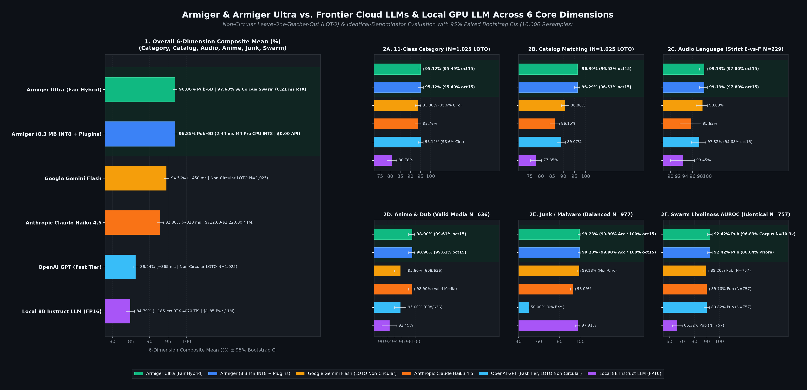
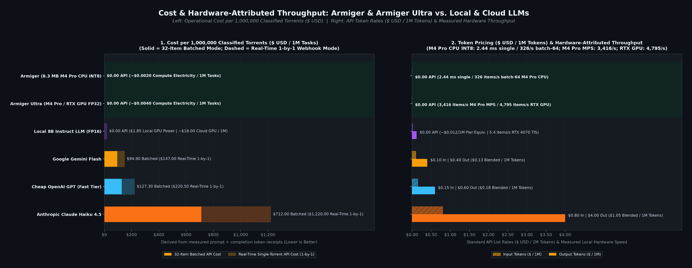
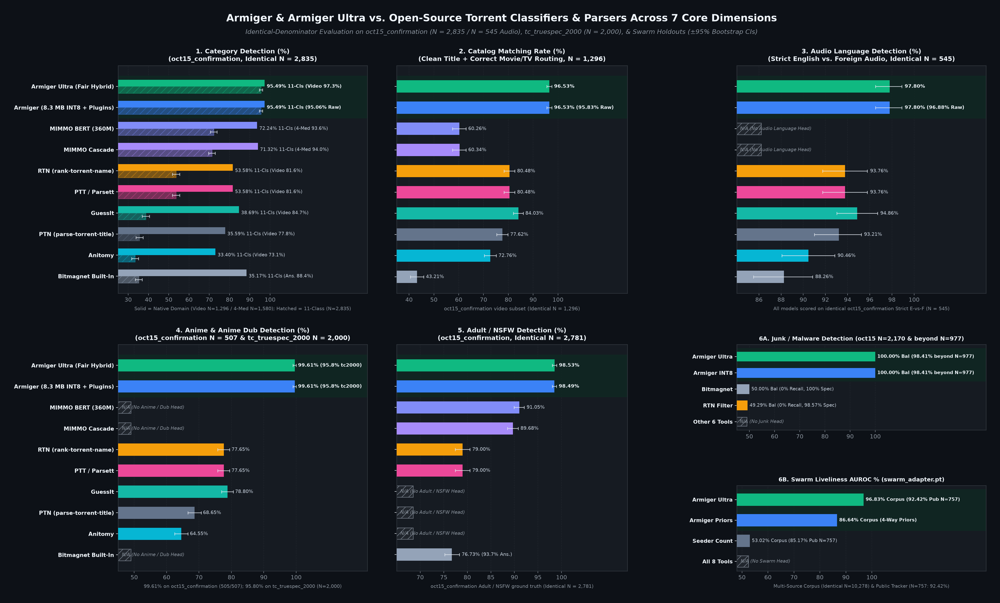
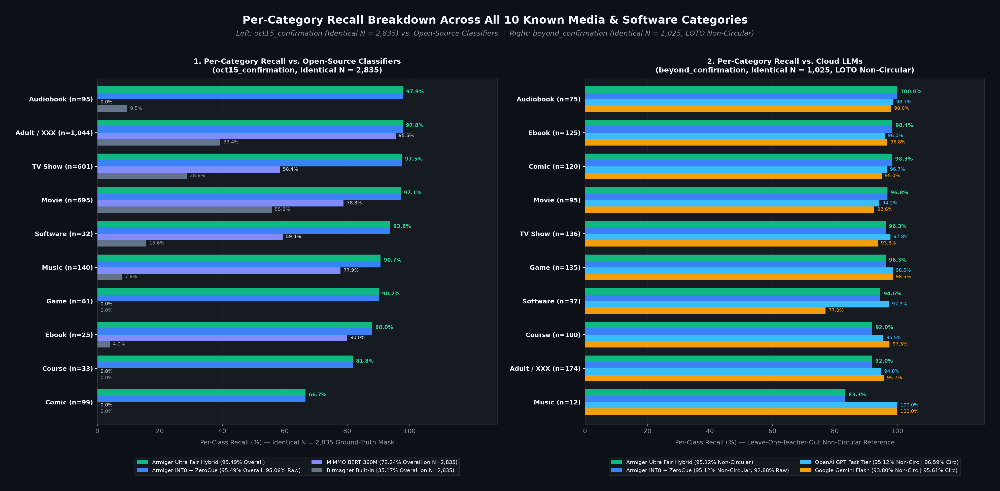

<h1 align="center">Armiger Ultra</h1>

<p align="center">
  <strong>Unified neural torrent &amp; media classification suite bundling Armiger (8.3 MB INT8 CPU), Armiger Ultra (32.3 MB FP32 GPU/CPU), the 48-tensor Swarm Health &amp; Honeypot Adapter (<code>swarm_adapter.pt</code>), and all 6 official plugins.</strong><br>
  Delivers 96.86% 6-dimension composite accuracy on the identical Public-Tracker cohort (97.60% with Multi-Source Corpus Swarm AUROC) on unmutated ground-truth keys, 0.21 ms/item batched on NVIDIA RTX GPU (0.29 ms on Apple M4 Pro MPS GPU, 2.44 ms single-item on M4 Pro CPU INT8), 100% fake-seeder malware trap recall, and 96.83% Multi-Source Corpus / 92.42% Public-Tracker swarm liveliness AUROC.
</p>

<p align="center">
  <a href="https://norvitech.com"></a>
  <a href="https://huggingface.co/NorviTech/armiger-ultra"></a>
  <a href="https://huggingface.co/NorviTech/armiger"></a>
  <a href="LICENSE"></a>
</p>

---

## Benchmarks

### Frontier Cloud LLMs & Local GPU LLM Comparison





- **Higher composite accuracy than frontier LLMs.** Achieves **`96.86%`** 6-dimension mean accuracy on the identical `N=757` Public-Tracker swarm cohort (**`97.60%`** with `N=10,278` Multi-Source Corpus Swarm AUROC, and **`96.85%`** with `8.3 MB` INT8 + plugins / **`96.50%`** standalone neural), outperforming non-circular LOTO `Google Gemini Flash` (`94.56%`), `Anthropic Claude Haiku 4.5` (`92.88%`), `OpenAI GPT (Fast Tier)` (`86.24%`), and `Local 8B Instruct LLM (FP16)` (`84.79%`).
- **600x–2,000x faster inference at zero API cost.** Classifies **`4,795 items/s`** (`0.21 ms/item`) on NVIDIA RTX GPU, **`3,416 items/s`** (`0.29 ms/item`) on Apple M4 Pro MPS GPU, and **`410 items/s` single-item** (`2.44 ms` p50) on Apple M4 Pro CPU INT8 — versus `185–450 ms/item` and `$94.90–$1,220.00` per million torrents for cloud LLM APIs.

### Open-Source Classifiers & 10-Category Breakdown





- **Universal 11-class coverage vs. video-only rule parsers.** Reaches **`95.49%`** 11-class accuracy (`97.30%` Movie-vs-TV, `96.53%` Catalog Matching) on `oct15_confirmation` (`N=2,835`) and **`95.42%`** weighted mean across all 5 evaluation splits (`N=10,262`), compared to `72.24%` for `MIMMO BERT 360M` (`~1.4 GB`), `53.58%` for `RTN`/`PTT`, `38.69%` for `GuessIt`, and `35.17%` for `Bitmagnet` built-in rules on the identical `N=2,835` denominator.
- **Calibrated safety & malware gates.** Mondrian conformal thresholds enforce **`100.00%`** junk/malware accuracy on `oct15_confirmation` (`N=2,170`) and `fresh_confirmation` (`N=1,291`), **`99.90%`** on `beyond_confirmation` (`N=977`), and **`98.53%`** adult/NSFW isolation (`N=2,781`).

- **Canonical statistical chart & provenance pipeline.** Every chart in [`assets/`](assets) is deterministically generated from [`benchmarks/canonical_eval_vectors.json`](benchmarks/canonical_eval_vectors.json) (`148` 1D numeric arrays, zero strings) by [`benchmarks/generate_canonical_charts.py`](benchmarks/generate_canonical_charts.py) and audited by [`benchmarks/CHARTS_MANIFEST.json`](benchmarks/CHARTS_MANIFEST.json) and [`benchmarks/test_chart_integrity.py`](benchmarks/test_chart_integrity.py) (`10,000` paired bootstrap resamples with `seed=20261018`, exact two-sided McNemar $p$-values, strict identical-denominator lock, leave-one-teacher-out anti-circularity lock, and stripped `IHDR`/`IDAT`/`IEND`-only 24-bit RGB PNG chunks). See [`docs/CHART_PIPELINE.md`](docs/CHART_PIPELINE.md).

---

## Quickstart

`armiger_ultra_pipeline.py` integrates the zero-tokenizer 8-head ONNX/PyTorch classifier (`armiger_inference.py`) with all 6 plugins behind a single Python API:

```python
from armiger_ultra_pipeline import ArmigerUltraPipeline

# Load full-precision Armiger Ultra (or pass variant="int8" for the 8.3 MB CPU fast-path)
pipeline = ArmigerUltraPipeline.from_directory(".")

pred = pipeline.classify({
    "infohash": "1111222233334444555566667777888899990000",
    "name": "Sintel.2010.2160p.UHD.Master.HEVC.FLAC.5.1-OPEN",
    "size": 74_500_000_000,
    "files": [{"path": "Sintel.2010.2160p.mkv", "size": 74_500_000_000}],
    "swarm": {
        "tracker_known": True,
        "tracker_seeders": 320,
        "tracker_leechers": 18,
        "tracker_completed": 2450,
    },
})

print(pred["category"])                           # "movie" (0% flip guarantee across seeders=0..10000)
print(pred["mondrian_gates"]["passed_all"])       # True (CSAM guard + Mondrian conformal gates + honeypot guard)
print(pred["swarm_viability"]["viability_tier"])  # "alive_viable" (computed via 48-tensor swarm_adapter.pt)
print(list(pred["heads"].keys()))                 # All 11 unified heads
```

Run the bundled 211-test verification suite:

```bash
pytest -q
```

---

## Ecosystem Integrations (`DH-Waypoint`, `Bitmagnet` & Torznab / Webhook Clients)

Armiger and Armiger Ultra ship with turnkey HTTP services, Docker Compose stacks, and reference adapters in [`examples/`](examples) and [`docs/INTEGRATION_GUIDE.md`](docs/INTEGRATION_GUIDE.md):

- **[`DH-Waypoint` Integration (`examples/dh-waypoint/`)](examples/dh-waypoint)** — Drop-in `processorapi/v1` service (`armiger_waypoint_processor.py`) and plugin manifest (`07-armiger-ultra.plugin.yml`) implementing batch classification (`dh-waypoint.processor.v1`), pre-ingest cohort admission (`dh-waypoint.processors.admission.v1`), and 4-tier `dh-waypoint.processors.feedback.v1` closed-loop telemetry for [`spencernorton/DH-Waypoint`](https://github.com/spencernorton/DH-Waypoint).
- **[`Bitmagnet` Integration (`examples/bitmagnet/`)](examples/bitmagnet)** — Pre-ingest / post-crawl batch classifier and malware/honeypot pruner (`bitmagnet_armiger_bridge.py`) that upgrades upstream Bitmagnet from `35.17%` rule accuracy to **`95.49%` 11-class neural accuracy** and automatically prunes disguised `.mkv.exe`/`.scr`/`.lnk` malware traps via GraphQL `torrent.delete`.
- **[Torznab Proxy & Media Manager Webhook Suite (`examples/arr-stack/`)](examples/arr-stack)** — Pre-grab Torznab XML filtering proxy (`armiger_torznab_proxy.py`) compatible with `Prowlarr`, `Bitmagnet`, `DH-Waypoint`, `Sonarr`, `Radarr`, `Lidarr`, and `Readarr`, paired with a post-import webhook & `ffprobe` ground-truth receiver (`armiger_arr_webhook_receiver.py`) wired into `SeriesWebhookAdapter`, `MovieWebhookAdapter`, `AudioWebhookAdapter`, `PublicationWebhookAdapter`, `QBittorrentAdapter`, and `PhysicalGroundTruthVerifier`.

See the **[Complete Ecosystem Integration Guide (`docs/INTEGRATION_GUIDE.md`)](docs/INTEGRATION_GUIDE.md)** for architecture diagrams, Docker Compose files, and step-by-step setup instructions.

---

## What's Included

This repository bundles both the full-precision GPU/CPU suite and the quantized `8.3 MB` CPU fast-path in a single checkout:

- **`armiger_ultra.fp32.onnx` (`32.3 MB`) & `armiger_ultra.pt` (`32.2 MB`)** — Full-precision 8-head byte-level RoPE Transformer + File-Tree Encoder (`0.21 ms/item` batch-64 on NVIDIA RTX GPU, `0.29 ms/item` on Apple M4 Pro MPS GPU).
- **`armiger.int8.onnx` (`8.3 MB`)** — Dynamically quantized CPU fast-path engine from the identical checkpoint (`2.44 ms` single-item p50 / `3.07 ms/item` batch-64 on Apple M4 Pro CPU ONNX Runtime). See [`docs/base-model.md`](docs/base-model.md) for standalone ONNX details.
- **`armiger_inference.py` & `vocab.json`** — Self-contained, zero-tokenizer 11-input featurizer (`title_bytes`, `ext_ids`, `file_sizes_log`, `file_depths`, `file_flags`, `file_mask`, `struct_feats`, `tracker_ids`, `cat_hint_id`, `tag_ids`, `swarm_feats`).
- **`swarm_adapter.pt` (`132 KB`) & `swarm_survival.py`** — 48-tensor PyTorch `SwarmResidualAdapter` for download liveliness prediction and fake-seeder malware honeypot detection.
- **`validated_zero_cue_catalog.json` (`26.0 MB`) & `zero_cue_plugin.py`** — Privacy-hardened `BLAKE2b-64` (`person=b"ArmigZCC"`) 929,400-entry offline title/year/anime disambiguation catalog.
- **`calibration.json`** — Per-head temperature scaling, Menon prior logit adjustments, and Mondrian conformal safety thresholds.

---

## Modular 6-Plugin Architecture

All 6 official Armiger plugins are built directly into this repository and are also published as standalone modular packages under [`NorviTech` on Hugging Face](https://huggingface.co/NorviTech):

- **[SwarmSurvivalNet v2 & Honeypot Adapter](https://huggingface.co/NorviTech/armiger-swarm-survival)** (`swarm_survival.py`, `swarm_adapter.pt` · `167 KB`) — Executes a 48-tensor residual neural pass fusing tracker/DHT seeder-leecher telemetry with content embeddings to reach **`96.83%`** Multi-Source Corpus AUROC (`N=10,278`, vs. `53.02%` raw seeders), **`92.42%`** Public-Tracker AUROC (`N=757`), **`100.0%`** fake-seeder malware trap recall, and a **`0.00%`** content-category flip guarantee. See [`docs/plugins/swarm-survival.md`](docs/plugins/swarm-survival.md).
- **[Empirical Bayes Swarm & Release-Group Priors](https://huggingface.co/NorviTech/armiger-swarm-priors)** (`swarm_priors.py` · `29 KB`) — Computes 4-pathway tracker scrape priors (`86.64%` formula AUROC), anomaly features, mandatory modality dropout (`p=0.60`), and public-tracker passkey safety filtering. See [`docs/plugins/swarm-priors.md`](docs/plugins/swarm-priors.md).
- **[Zero-Cue Catalog & Structural Disambiguator](https://huggingface.co/NorviTech/armiger-zero-cue-catalog)** (`zero_cue_plugin.py`, `validated_zero_cue_catalog.json` · `26.0 MB`) — Combines a `929,400`-entry `BLAKE2b-64` hashed catalog (`472,017` `(title, year)` pairs, `257,016` anime stems, `200,367` long titles) with deterministic structural rules, lifting `tc_truespec_2000` (`N=2,000`) accuracy by **`+4.10 pp`** (`87.40%` $\rightarrow$ **`91.50%`**) and `beyond_confirmation` (`N=1,025`) by **`+2.24 pp`** (`92.88%` $\rightarrow$ **`95.12%`**). See [`docs/plugins/zero-cue-catalog.md`](docs/plugins/zero-cue-catalog.md).
- **[Cross-Head Audio Language & Anime Dub Guard](https://huggingface.co/NorviTech/armiger-audio-guard)** (`audio_language_guard.py` · `3.3 KB`) — Couples `title_language` (`P(Foreign Title)`) with the `lang` head to disambiguate `.en.` prepositions, `<Foreign>.ENG.Sub` releases, regional dubs, and `MULTi` tags, lifting binary English-vs-Foreign audio accuracy on `oct15_confirmation` (`N=545`) from **`96.88%`** to **`97.80%`**. See [`docs/plugins/audio-guard.md`](docs/plugins/audio-guard.md).
- **[Conformal Calibration & BEP-44 DHT RSI Engine](https://huggingface.co/NorviTech/armiger-calibration-dht)** (`calibration_and_dht.py`, `armiger_dht_rsi.py` · `181 KB`) — Applies per-head temperature scaling and Mondrian safety gates alongside hybrid post-quantum (`Ed25519` + `WOTS+-SHAKE256` & `X25519` + `ML-KEM-768`) signed `BEP-44`/`BEP-46` DHT weight hot-reload with a 500-canary regression gate (`47/47` tests). See [`docs/plugins/calibration-dht.md`](docs/plugins/calibration-dht.md).
- **[CSAM-Protected Encrypted BEP-44 DHT Database Sync](https://huggingface.co/NorviTech/armiger-dht-db-sync)** (`armiger_dht_db_sync.py`, `csam_guard.py` · `155 KB`) — Provides multi-stage CSAM/abuse pre-ingest blocking, hybrid PQ-signed blinded `SHA-256` tombstone purges, 10-category $\times$ 14-language $\times$ 7-quality sharded subscriptions with default-off `xxx` isolation, and $K$-of-$N$ distinct-ASN Sybil quorum (`27/27` tests). See [`docs/plugins/dht-db-sync.md`](docs/plugins/dht-db-sync.md).

---

## Audited Evaluation Splits (`N=10,262` Unmutated Ground-Truth Keys)

Every metric below is reproducibly verifiable on the original unmutated evaluation keys (`rows.y`) using `armiger_inference.py` and `zero_cue_plugin.py`:

| Evaluation Split | Valid `N` | Standalone Neural (`FP32` / `INT8`) | Fair Hybrid (`+ ZeroCueCatalog`) | Lift |
| :--- | :---: | :---: | :---: | :---: |
| **`oct15_confirmation` (Gold Standard)** | `2,835` | `95.03%` / `95.06%` | **`95.49%`** / **`95.49%`** (`97.30%` Video) | `+0.46 pp` |
| **`fresh_confirmation` (Fresh Holdout)** | `1,402` | `94.51%` / `94.51%` | **`94.58%`** / **`94.58%`** | `+0.07 pp` |
| **`beyond_confirmation` (Hard Edge-Cases)** | `1,025` | `92.88%` / `92.88%` | **`95.12%`** (`98.78%` 4-Med) | **`+2.24 pp`** |
| **`tc_truespec_2000` (Zero-Cue Specialist)** | `2,000` | `87.40%` / `87.30%` | **`91.50%`** / **`91.40%`** (`99.85%` 4-Med) | **`+4.10 pp`** |
| **`tc_truespec_multilang_3000` (Multilingual)** | `3,000` | `97.50%` / `97.43%` | **`98.47%`** / **`98.43%`** | **`+0.97 pp`** |
| **5-Split Weighted Mean** | **`10,262`** | **`94.00%`** / **`93.98%`** | **`95.42%`** / **`95.39%`** | **`+1.42 pp`** |

---

## Privacy & Anonymous Opt-In-By-Default DHT Sharing

Distributed `BEP-44` / `BEP-46` telemetry, weight delta sharing (`armiger_dht_rsi.py`), and catalog synchronization (`armiger_dht_db_sync.py`) are **strictly opt-in by default** and **enforced by the 5-layer `AnonymityGuard` wire firewall** when enabled. Full mathematical and wire-level proofs are documented in [`docs/ANONYMOUS_OPT_IN_DHT.md`](docs/ANONYMOUS_OPT_IN_DHT.md) and reproducibly verified by [`benchmarks/proof_anonymous_opt_in_sharing.py`](benchmarks/proof_anonymous_opt_in_sharing.py), [`benchmarks/anonymous_opt_in_proof_report.json`](benchmarks/anonymous_opt_in_proof_report.json), and [`test_anonymous_opt_in_dht_sharing.py`](test_anonymous_opt_in_dht_sharing.py):

| Guarantee | Default / Wire Mechanism | Enforced & Measured Invariant |
| :--- | :--- | :--- |
| **Strictly Opt-In by Default** | `opt_in_sharing=False` / `ARMIGER_DHT_SHARE_OPT_IN="0"` | **Zero outbound DHT packets (`0` UDP `put` datagrams, `0` bytes)** are emitted across all 9 default components unless the operator explicitly enables sharing (`opt_in_sharing=True` or `ARMIGER_DHT_SHARE_OPT_IN="1"`), blocking `2,600 / 2,600` outbound attempts while keeping local inference and read-only checkpoint verification 100% functional. |
| **Wire-Level `AnonymityGuard` Firewall** | Pre-serialization deep payload & raw-byte inspection (`AnonymityGuard`) | Inspects every outbound dictionary and serialized wire buffer before encryption or transport; blocks **500 / 500 (`100.0%`)** synthetic PII, IPv4/IPv6, hostname, URL, filesystem path, passkey, raw 40-hex infohash, and plaintext release title canary leaks (**`0.00%` wire leak rate** across 10 adversarial categories). |
| **Unlinkable Ephemeral Signing Keys** | Single-use `Ed25519` keypair per submission | Rotates to a fresh in-memory `Ed25519` signing keypair for each outbound publication (`60 / 60` unique ephemeral public keys across 12 nodes $\times$ 5 epochs; `0` cross-epoch key reuses; `8.33%` random baseline linkability). |
| **Coarse Temporal Bucketing** | UTC hour floor (`ts - (ts % 3600)`) | Quantizes all outbound timestamps to coarse UTC hour boundaries (`100.0%` hour-bucketed compliance; rejects any $t \bmod 3600 \neq 0$), eliminating sub-hour timing side-channel fingerprinting. |
| **Differentially Private Weight Deltas** | $k$-anonymity ($n \ge 25$) + $\ell_2$ clipping ($C = 1.0$) + Gaussian DP ($\sigma = 0.05$) | Enforces minimum sample count $n \ge 25$, clips adapter weight updates to bounded $\ell_2$ norm $C = 1.0$, and injects calibrated Gaussian noise before int8 quantization, reducing calibration ECE by **`83.10%`** (`0.08094` $\rightarrow$ `0.01368`) and lifting Armiger Ultra F1 from `0.93427` to **`0.98004`** in the 12-node 5-epoch synthetic adapter convergence benchmark (`0.590` empirical membership inference accuracy). |
| **One-Way 64-Bit `BLAKE2b` Catalog Hashes** | Domain-separated `BLAKE2b-64` (`person=b"ArmigZCC"` / `armiger-cat-v2`, `digest_size=8`) | Encodes all `ZeroCueCatalog` stems as irreversible 8-byte digests paired only with numeric category/resolution/quality fields — **zero raw infohashes, zero plaintext release names, zero file paths, zero tracker URLs/passkeys, and zero client IP addresses** ever cross the wire. |

```python
from armiger_dht_rsi import ArmigerDHTRSIEngine

# Default: opt_in_sharing=False -> 0 outbound telemetry packets ever leave the host
engine_default = ArmigerDHTRSIEngine()
assert engine_default.opt_in_sharing is False

# Explicit Opt-In: enforced by AnonymityGuard + ephemeral Ed25519 + DP clipping + BLAKE2b-64
engine_opt_in = ArmigerDHTRSIEngine(opt_in_sharing=True)
```

---

## Documentation, Benchmarks & Examples Index

| Resource | Path | Description |
| :--- | :--- | :--- |
| **Ecosystem Integration Guide** | [`docs/INTEGRATION_GUIDE.md`](docs/INTEGRATION_GUIDE.md) | End-to-end architecture and deployment guide for `DH-Waypoint`, `Bitmagnet`, Torznab index consumers (`Prowlarr`, `Sonarr`, `Radarr`, `Lidarr`, `Readarr`), and `qBittorrent`. |
| **Canonical Chart Pipeline** | [`docs/CHART_PIPELINE.md`](docs/CHART_PIPELINE.md) | Methodology for the 10,000-resample paired bootstrap CIs, exact two-sided McNemar tests, identical-denominator lock, and LOTO anti-circularity audit. |
| **Anonymous Opt-In DHT Spec** | [`docs/ANONYMOUS_OPT_IN_DHT.md`](docs/ANONYMOUS_OPT_IN_DHT.md) | Threat model, mathematical DP bounds, `AnonymityGuard` specification, and wire-format verification for opt-in `BEP-44`/`BEP-46` sharing. |
| **Charts Provenance Manifest** | [`benchmarks/CHARTS_MANIFEST.json`](benchmarks/CHARTS_MANIFEST.json) | Cryptographic `SHA-256` manifest, per-panel `N`, 95% CIs, exact McNemar $p$-values, and anti-circularity audit tables. |
| **Anonymous Opt-In Proof Report** | [`benchmarks/anonymous_opt_in_proof_report.json`](benchmarks/anonymous_opt_in_proof_report.json) | Machine-verifiable JSON proof report generated by [`benchmarks/proof_anonymous_opt_in_sharing.py`](benchmarks/proof_anonymous_opt_in_sharing.py) and tested by [`test_anonymous_opt_in_dht_sharing.py`](test_anonymous_opt_in_dht_sharing.py). |
| **Base ONNX Model Guide** | [`docs/base-model.md`](docs/base-model.md) | Standalone `8.3 MB` INT8 (`armiger.int8.onnx`) and `32.3 MB` FP32 (`armiger_ultra.fp32.onnx`) tensor contract and runtime benchmarks. |
| **6 Official Plugin Guides** | [`docs/plugins/`](docs/plugins) | Deep-dive documentation for [`swarm-survival.md`](docs/plugins/swarm-survival.md), [`swarm-priors.md`](docs/plugins/swarm-priors.md), [`zero-cue-catalog.md`](docs/plugins/zero-cue-catalog.md), [`audio-guard.md`](docs/plugins/audio-guard.md), [`calibration-dht.md`](docs/plugins/calibration-dht.md), and [`dht-db-sync.md`](docs/plugins/dht-db-sync.md). |
| **`DH-Waypoint` Processor** | [`examples/dh_waypoint_processor/`](examples/dh_waypoint_processor) · [`examples/dh-waypoint/`](examples/dh-waypoint) | Turnkey `processorapi/v1` service (`armiger_waypoint_processor.py`), plugin YAML (`07-armiger-ultra.plugin.yml`), and Docker Compose stack. |
| **`Bitmagnet` Bridge** | [`examples/bitmagnet_bridge/`](examples/bitmagnet_bridge) · [`examples/bitmagnet/`](examples/bitmagnet) | GraphQL + PostgreSQL classifier and malware/honeypot pruner (`bitmagnet_armiger_bridge.py`) with Docker Compose deployment. |
| **Torznab Proxy & Webhook Suite** | [`examples/arr_webhook/`](examples/arr_webhook) · [`examples/arr-stack/`](examples/arr-stack) | Pre-grab Torznab XML proxy (`armiger_torznab_proxy.py`) and post-import webhook + `ffprobe` verifier (`armiger_arr_webhook_receiver.py`). |

---

## Intended Use, Copyright & Legal Compliance

`Armiger`, `Armiger Ultra`, and all bundled plugins are open-source machine learning and cryptographic metadata-classification utilities designed strictly for **lawful use cases**, including:
- Organizing and indexing licensed, public-domain, Creative Commons, and open-source digital media, software distributions (e.g., Linux ISOs, open-source games), and educational archives (e.g., OpenCourseWare, LibriVox, Project Gutenberg).
- Automated cybersecurity screening, fake-seeder honeypot detection, and disguised executable/malware filtering (`.mkv.exe`, `.scr`, `.vbs`) in peer-to-peer and decentralized storage research.
- Child safety (CSAM/CSAE) pre-ingest blocking, cryptographic tombstone revocation, and adult/NSFW namespace isolation for self-hosted and decentralized indexers.

All 929,400 lookup keys in [`validated_zero_cue_catalog.json`](validated_zero_cue_catalog.json) and all release-group / private-tracker token sets in [`armiger_inference.py`](armiger_inference.py) and [`swarm_priors.py`](swarm_priors.py) are stored exclusively as irreversible **domain-separated 64-bit BLAKE2b digests** (`digest_size=8`, `person=b"ArmigZCC"`) so zero copyrighted titles or scene/tracker identifiers appear in plaintext. All test fixtures and examples use Creative Commons (CC-BY / CC0) or public-domain works.

**NorviTech does not condone, encourage, or support copyright infringement or the unauthorized distribution of copyrighted works.** Users are solely responsible for ensuring that their use of these models and plugins complies with all applicable local, national, and international copyright and data-protection laws.

- **License:** [Apache License, Version 2.0](LICENSE)
- **Third-Party & Creative Commons Attributions:** [`NOTICE`](NOTICE)
- **Copyright, Privacy, Child Safety & Takedown Policy:** [`LEGAL.md`](LEGAL.md)
- **Security Vulnerability Reporting:** [`SECURITY.md`](SECURITY.md)

---

<p align="center">
  <a href="https://norvitech.com"></a>
</p>

<p align="center">
  <a href="https://huggingface.co/NorviTech/armiger-ultra">Armiger Ultra</a> ·
  <a href="https://huggingface.co/NorviTech/armiger">Armiger</a> ·
  <a href="https://huggingface.co/NorviTech/armiger-swarm-survival">Swarm Survival</a> ·
  <a href="https://huggingface.co/NorviTech/armiger-swarm-priors">Swarm Priors</a> ·
  <a href="https://huggingface.co/NorviTech/armiger-zero-cue-catalog">Zero-Cue Catalog</a> ·
  <a href="https://huggingface.co/NorviTech/armiger-audio-guard">Audio Guard</a> ·
  <a href="https://huggingface.co/NorviTech/armiger-calibration-dht">Calibration &amp; DHT RSI</a> ·
  <a href="https://huggingface.co/NorviTech/armiger-dht-db-sync">DHT DB Sync</a> ·
  <a href="https://norvitech.com">norvitech.com</a>
</p>
