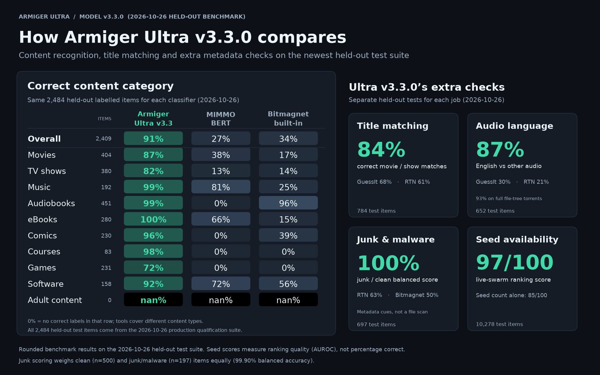

<h1 align="center">Armiger</h1>

  
  
  
  
  
  

Armiger helps Bitmagnet and Rats Search label torrents by type and language, using names and file lists. **Armiger Ultra** also adds title matching, audio-language checks and estimates of download availability. It runs on a CPU; no GPU or paid API is required.

## Choose your setup

1. **[Bitmagnet + Armiger Ultra](examples/bitmagnet/README.md)** — classify items and add searchable tags in Bitmagnet.
2. **[Rats Search + Armiger Ultra](examples/rats-search/README.md)** — classify items in Rats Search.
3. **[Standalone Armiger Ultra](docs/quickstart.md)** — run the ready-made Armiger container on its own.

Choose one guide. The Docker setups include Armiger Ultra, so you do **not** need to install the standalone version first. Both integration guides start with a fresh, all-in-one installation. Save the small Compose file from your guide and run `docker compose up -d`; no source build or Python installation is needed.

## What Armiger does

Armiger reads names, file paths, sizes and optional swarm counters. It predicts content type, language, subtitle availability and other metadata. Ultra combines those predictions with its catalog and additional checks.

It does not inspect media payloads. Metadata predictions can be wrong and do not prove that a download is safe. See [evaluation and limitations](docs/evaluation.md) for measured results and label coverage. Sharing is off by default.

## More information

- [Armiger on NorviTech](https://norvitech.com/ai-models/#armiger)
- [Armiger Ultra settings for Bitmagnet](docs/bitmagnet-configuration.md)
- [Python API and component reference](docs/reference.md)
- [Optional distributed updates](docs/distributed-updates.md)
- [Other integrations](https://github.com/spencernorton/Armiger-Connectors) — DH-Waypoint, Torznab and Arr.
- [Help and bug reports](https://github.com/spencernorton/armiger/issues) · [Contributing](.github/CONTRIBUTING.md) · [Security reporting](.github/SECURITY.md)

Library **3.3.2** uses model bundle **3.3.0**. The Docker image includes verified model files. Python installs download them from a fixed [Hugging Face](https://huggingface.co/NorviTech/armiger-ultra) revision and verify them before use. Apache-2.0: [license](LICENSE), [notices](NOTICE), [use policy](.github/LEGAL.md).

---

  

  <a href="https://github.com/spencernorton/helios">Helios</a> ·
  <a href="https://github.com/spencernorton/DH-Waypoint">DH-Waypoint</a> ·
  <a href="https://github.com/spencernorton/armiger">Armiger</a> ·
  <a href="https://github.com/spencernorton/xnote">XNote</a> ·
  <a href="https://github.com/spencernorton/xnote-placement">XNote Placement</a> ·
  <a href="https://github.com/spencernorton/snipsnap">SnipSnap</a> ·
  <a href="https://github.com/spencernorton/conductor">Conductor</a> ·
  <a href="https://github.com/spencernorton/norvi-os">NorviOS</a> ·
  <a href="https://github.com/spencernorton/indigo">Indigo</a> ·
  <a href="https://github.com/spencernorton/roadtrack">Road Track</a> ·
  <a href="https://norvitech.com">norvitech.com</a>

