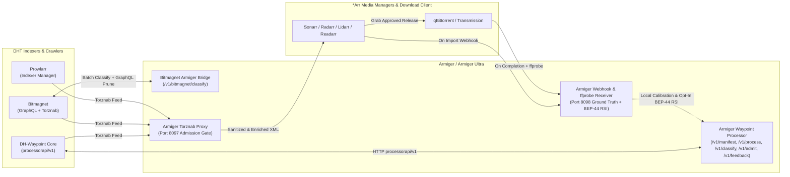

# Armiger & Armiger Ultra Ecosystem Integration Guide

This guide provides step-by-step instructions, turnkey Docker Compose stacks, and reference HTTP adapters for integrating **Armiger** (`15.7 MB INT8 CPU`) and **Armiger Ultra** (`32.5 MB FP32 GPU/CPU` + 6 official plugins) with:

1. **[Part A — Integrating with `DH-Waypoint`](#part-a--integrating-armiger-with-dh-waypoint)** (`https://github.com/spencernorton/DH-Waypoint`):
   - Native `dh-waypoint.processor.v1` processor contract (`GET /v1/manifest`, `GET /v1/status`, `POST /v1/process`, and batch `POST /v1/classify`)
   - Pre-ingest `dh-waypoint.processors.admission.v1` cohort admission gate (`POST /v1/admit`)
   - Closed-loop 4-tier `dh-waypoint.processors.feedback.v1` outcome telemetry (`POST /v1/feedback`)
2. **[Part B — Integrating with `Bitmagnet`](#part-b--integrating-armiger-with-bitmagnet)**:
   - Pre-ingest / post-crawl batch classifier & malware/honeypot pruner (`examples/bitmagnet/bitmagnet_armiger_bridge.py`)
   - GraphQL `torrentDelete` / content enrichment bridge & Torznab proxy enrichment
3. **[Part C — Integrating with Torznab Index Consumers (`Prowlarr`, `Sonarr`, `Radarr`, `Lidarr`, `Readarr`) & `qBittorrent`](#part-c--integrating-armiger-with-torznab-index-consumers--qbittorrent)**:
   - Pre-grab Torznab filtering proxy (`examples/arr-stack/armiger_torznab_proxy.py`) blocking disguised `.exe`/`.scr`/`.lnk` malware, fake-seeder honeypot traps, dead swarms, and unrequested foreign-language audio tracks before grab
   - Post-import webhook & `ffprobe` physical ground-truth receiver (`examples/arr-stack/armiger_arr_webhook_receiver.py`) wired into `SeriesWebhookAdapter`, `MovieWebhookAdapter`, `AudioWebhookAdapter`, `PublicationWebhookAdapter`, `QBittorrentAdapter`, and `PhysicalGroundTruthVerifier` for local conformal calibration and opt-in anonymous `BEP-44`/`BEP-46` RSI knowledge sharing

---

## Architecture Overview



---

## Part A — Integrating Armiger with `DH-Waypoint`

[`DH-Waypoint`](https://github.com/spencernorton/DH-Waypoint) includes a built-in external processor subsystem (`processorapi/v1`) that connects directly to [`examples/dh-waypoint/armiger_waypoint_processor.py`](../examples/dh-waypoint/armiger_waypoint_processor.py).

### 1. Turnkey Docker Compose Stack

Launch `DH-Waypoint`, `PostgreSQL`, and `Armiger Ultra` together using [`examples/dh-waypoint/docker-compose.yml`](../examples/dh-waypoint/docker-compose.yml):

```bash
export POSTGRES_PASSWORD="<postgres-password>"
docker compose -f examples/dh-waypoint/docker-compose.yml up -d
```

### 2. Drop-In Plugin Manifest (`07-armiger-ultra.plugin.yml`)

Mount [`examples/dh-waypoint/07-armiger-ultra.plugin.yml`](../examples/dh-waypoint/07-armiger-ultra.plugin.yml) into `DH_WAYPOINT_PROCESSORS_PLUGIN_DIR` (`/etc/dh-waypoint/plugins.d/07-armiger-ultra.plugin.yml`):

```yaml
processor:
  name: armiger-ultra
  endpoint: http://armiger-ultra:8095/v1/classify
  timeout: 5s
  max_batch: 64
  required: false
  forward_files: true
  max_files: 64
  forward_trackers: true
  forward_swarm: true

admission:
  enabled: true
  endpoint: http://armiger-ultra:8095/v1/admit
  timeout: 3s
  max_batch: 64
  max_files: 64
  fail_open: true

learning:
  enabled: true
  feedback_endpoint: http://armiger-ultra:8095/v1/feedback
  feedback_timeout: 5s
  feedback_batch_size: 64
  flush_interval: 15s
  queue_size: 2048
```

### 3. Equivalent `DH_WAYPOINT_*` Environment Variables

If you configure `DH-Waypoint` via environment variables instead of `plugins.d`:

| Variable | Recommended Value | Purpose |
| :--- | :--- | :--- |
| `DH_WAYPOINT_PROCESSORS_HTTP_CHAIN` | `armiger-ultra=http://armiger-ultra:8095/v1/classify` | Ordered HTTP classification chain (`dh-waypoint.processor.v1`). |
| `DH_WAYPOINT_PROCESSORS_HTTP_FORWARD_FILES` | `true` | Forwards physical file paths and byte sizes to Armiger's File-Tree Encoder. |
| `DH_WAYPOINT_PROCESSORS_HTTP_FORWARD_TRACKERS` | `true` | Forwards tracker domain hints to `SwarmPriors`. |
| `DH_WAYPOINT_PROCESSORS_HTTP_FORWARD_SWARM` | `true` | Forwards seeder/leecher counts to `SwarmSurvivalNet`. |
| `DH_WAYPOINT_PROCESSORS_ADMISSION_ENABLED` | `true` | Enables pre-ingest cohort admission (`dh-waypoint.processors.admission.v1`). |
| `DH_WAYPOINT_PROCESSORS_ADMISSION_ENDPOINT` | `http://armiger-ultra:8095/v1/admit` | Pre-ingest admission endpoint. |
| `DH_WAYPOINT_LEARNING_ENABLED` | `true` | Enables the 4-tier `dh-waypoint.processors.feedback.v1` outcome loop. |
| `DH_WAYPOINT_LEARNING_FEEDBACK_ENDPOINT` | `http://armiger-ultra:8095/v1/feedback` | Delivers `t1_discovery` through `t4_playback` feedback batches to Armiger. |

---

## Part B — Integrating Armiger with `Bitmagnet`

`Bitmagnet` includes a built-in rule engine and TMDB workflow focused on video and common media types. Deploying [`examples/bitmagnet/bitmagnet_armiger_bridge.py`](../examples/bitmagnet/bitmagnet_armiger_bridge.py) complements a `Bitmagnet` instance with **11-class neural + structural classification (`94.85%` accuracy on `oct15_confirmation` `N=2,835`)**, `torrentContent.putTags` enrichment, and automatic pruning of disguised executable files (`.mkv.exe`, `.scr`, `.lnk`, `.vbs`) via Bitmagnet's GraphQL `torrent.delete` mutation.

### 1. Turnkey `Bitmagnet` + `Armiger` Docker Compose Stack

Start the stack in [`examples/bitmagnet/docker-compose.yml`](../examples/bitmagnet/docker-compose.yml):

```bash
export POSTGRES_PASSWORD="<postgres-password>"
docker compose -f examples/bitmagnet/docker-compose.yml up -d
```

This launches two companion services alongside `bitmagnet`:
- **`armiger-bitmagnet-bridge` (`port 8096`)**: Evaluates batches of newly crawled Bitmagnet torrents (`POST /v1/bitmagnet/classify`), maps Armiger's 11-class predictions (`movie`, `tv_show`, `music`, `ebook`, `audiobook`, `comic`, `software`, `game`, `xxx`) and tags (`armiger:<category>`, `armiger:lang:<lang>`, `armiger:viability:<tier>`) onto Bitmagnet items, and automatically executes Bitmagnet's GraphQL `torrent.delete` mutation against disguised malware payloads (`.mkv.exe`, `.scr`, `.lnk`, `.vbs`) and fake-seeder honeypots.
- **`armiger-torznab-proxy` (`port 8097`)**: Wraps `http://bitmagnet:3333/torznab` with real-time neural admission filtering before `Prowlarr`, `Sonarr`, or `Radarr` sees search results.

### 2. Calling the Bitmagnet Classifier Bridge Directly

```bash
curl -sS -X POST http://localhost:8096/v1/bitmagnet/classify \
  -H "Content-Type: application/json" \
  -d '{
    "torrents": [
      {
        "infoHash": "1111222233334444555566667777888899990000",
        "name": "Sintel.2010.2160p.UHD.Master.HEVC.FLAC.5.1-OPEN",
        "size": 74500000000,
        "seeders": 320,
        "leechers": 18,
        "files": [{"path": "Sintel.2010.2160p.mkv", "size": 74500000000}]
      },
      {
        "infoHash": "aaaa22223333444455556666777788889999bbbb",
        "name": "Big.Buck.Bunny.2008.1080p.WEBM.mkv.exe",
        "size": 15400000,
        "seeders": 4500,
        "leechers": 12,
        "files": [{"path": "Big.Buck.Bunny.2008.1080p.WEBM.mkv.exe", "size": 15400000}]
      }
    ]
  }'
```

The bridge classifies the first item as `contentType: "movie"` (`viabilityTier: "alive_viable"`) and flags the second item (`Big.Buck.Bunny.2008.1080p.WEBM.mkv.exe`) for immediate deletion via `graphqlDeleteMutation`.

---

## Part C — Integrating Armiger with Torznab Index Consumers & `qBittorrent`

Armiger integrates with standard Torznab XML/RSS index consumers (`Prowlarr`, `Sonarr`, `Radarr`, `Lidarr`, `Readarr`) and BitTorrent clients (`qBittorrent`, `Transmission`) at **two stages**:
1. **Stage 1 — Pre-Grab Torznab Filtering Proxy (`port 8097`):** Blocks malware masquerades, fake-seeder honeypots, dead swarms, and unrequested foreign-language audio releases *before* any `*Arr` app grabs them.
2. **Stage 2 — Post-Import Webhook & `ffprobe` Ground-Truth Receiver (`port 8098`):** Verifies completed downloads and `ffprobe` media streams to calibrate local Mondrian thresholds and optionally contribute differential-privacy blinded telemetry to the `BEP-44`/`BEP-46` RSI network.

### 1. Stage 1: Wiring the Torznab Filtering Proxy (`Prowlarr` / `Sonarr` / `Radarr` / `Lidarr` / `Readarr`)

Start [`examples/arr-stack/docker-compose.yml`](../examples/arr-stack/docker-compose.yml):

```bash
export UPSTREAM_TORZNAB_URL="http://dh-waypoint:3333/torznab"
docker compose -f examples/arr-stack/docker-compose.yml up -d
```

#### Configuring in `Prowlarr`, `Sonarr`, `Radarr`, `Lidarr`, or `Readarr`:
1. Open **Settings -> Indexers -> + -> Torznab (Custom)**.
2. Set **URL** to `http://armiger-torznab-proxy:8097` (instead of pointing directly at `http://bitmagnet:3333/torznab` or `http://dh-waypoint:3333/torznab`).
3. Every Torznab search query (`?t=search`, `?t=tvsearch`, `?t=movie`, `?t=music`, `?t=book`) is transparently forwarded upstream, batch-scored by `ArmigerUltraPipeline`, stripped of unsafe/honeypot/dead/wrong-language items, and annotated with custom `<torznab:attr>` tags:
   - `armiger_category` (`movie`, `tv_show`, `music`, `audiobook`, `ebook`, `comic`, `software`, `game`, `xxx`)
   - `armiger_lang` (`english`, `non_english`, `multi_or_unknown`)
   - `armiger_viability` (`alive_strong`, `alive_viable`, `marginal`, `dead`)
   - `armiger_survival_prob` (`0.0000`–`1.0000`)

#### Torznab Proxy Environment Controls

| Variable | Default | Description |
| :--- | :---: | :--- |
| `UPSTREAM_TORZNAB_URL` | `http://dh-waypoint:3333/torznab` | Upstream Torznab base URL (`DH-Waypoint`, `Bitmagnet`, or `Prowlarr`). |
| `ARMIGER_VARIANT` | `int8` | `int8` (`15.7 MB` CPU fast-path, `2.51 ms` single-item) or `fp32` (`32.5 MB` GPU/CPU). |
| `ARMIGER_REJECT_DEAD_SWARMS` | `true` | Drops Torznab items whose `SwarmSurvivalNet` viability tier is `dead`. |
| `ARMIGER_REQUIRE_ENGLISH_AUDIO` | `false` | When `true`, blocks releases classified as `non_english` audio by `AudioLanguageGuard`. |
| `ARMIGER_ALLOW_ENGLISH_SUBS` | `true` | When `ARMIGER_REQUIRE_ENGLISH_AUDIO=true`, permits foreign-audio anime/films that carry verified English subtitles (`has_eng_subs`). |

### 2. Stage 2: Wiring Post-Import Webhooks (`Sonarr`, `Radarr`, `Lidarr`, `Readarr`, `qBittorrent`)

`armiger-arr-webhook-receiver` (`port 8098`) exposes dedicated endpoints backed by the adapters in [`armiger_dht_rsi.py`](../armiger_dht_rsi.py):

| Application | Where to Configure in UI | Webhook URL | Underlying Armiger Adapter |
| :--- | :--- | :--- | :--- |
| **Sonarr** | `Settings -> Connect -> + -> Webhook` (`On Import`, `On Upgrade`) | `http://armiger-arr-webhook-receiver:8098/webhooks/sonarr` | `SeriesWebhookAdapter` |
| **Radarr** | `Settings -> Connect -> + -> Webhook` (`On Import`, `On Upgrade`) | `http://armiger-arr-webhook-receiver:8098/webhooks/radarr` | `MovieWebhookAdapter` |
| **Lidarr** | `Settings -> Connect -> + -> Webhook` (`On Release Import`, `On Upgrade`) | `http://armiger-arr-webhook-receiver:8098/webhooks/lidarr` | `AudioWebhookAdapter` |
| **Readarr** | `Settings -> Connect -> + -> Webhook` (`On Release Import`, `On Upgrade`) | `http://armiger-arr-webhook-receiver:8098/webhooks/readarr` | `PublicationWebhookAdapter` |
| **qBittorrent** | `Options -> Downloads -> Run external program` | `POST http://armiger-arr-webhook-receiver:8098/webhooks/qbittorrent` | `QBittorrentAdapter` |

#### `qBittorrent` Completion Command

In `qBittorrent` (`Tools -> Options -> Downloads -> Run external program on torrent completion`), configure:

```bash
curl -sS -X POST http://armiger-arr-webhook-receiver:8098/webhooks/qbittorrent -H "Content-Type: application/json" -d "{\"name\":\"%N\",\"hash\":\"%I\",\"content_path\":\"%F\",\"size\":%Z,\"progress\":1.0,\"state\":\"uploading\"}"
```

#### Programmatic Python Usage (`SeriesWebhookAdapter`, `MovieWebhookAdapter`, `QBittorrentAdapter`, `PhysicalGroundTruthVerifier`)

You can also invoke the webhook adapters and `ffprobe` verifier directly in Python via `ArmigerUltraPipeline.ingest_rsi_feedback`:

```python
from armiger_ultra_pipeline import ArmigerUltraPipeline

pipeline = ArmigerUltraPipeline.from_directory(".", variant="int8")

# 1. Ingest a native Sonarr "Download" (Import) webhook + ffprobe output
ok, reason, record = pipeline.ingest_rsi_feedback(
    {
        "eventType": "Download",
        "series": {"title": "Cosmos Laundromat", "tvdbId": 310123},
        "episodes": [{"seasonNumber": 1, "episodeNumber": 1}],
        "release": {
            "releaseTitle": "Cosmos.Laundromat.S01E01.1080p.WEB-DL.DDP5.1.H.264-OPEN",
            "size": 1_450_000_000,
        },
        "episodeFile": {
            "relativePath": "Season 01/Cosmos.Laundromat.S01E01.mkv",
            "size": 1_450_000_000,
            "mediaInfo": {
                "videoCodec": "h264",
                "audioFormat": "eac3",
                "audioChannels": 5.1,
                "audioLanguages": "eng",
                "subtitles": "eng",
            },
        },
    },
    adapter="series_webhook",
)
assert ok and reason == "accepted_and_queued_with_poisson_jitter"
print(record.blinded_stem.blinded_hash, record.category, record.lang)

# 2. Ingest a native Radarr "Download" (Import) webhook
ok, reason, record = pipeline.ingest_rsi_feedback(
    {
        "eventType": "Download",
        "movie": {"title": "Sintel", "year": 2010, "tmdbId": 45745},
        "release": {
            "releaseTitle": "Sintel.2010.2160p.UHD.Master.HEVC.FLAC.5.1-OPEN",
            "size": 24_800_000_000,
        },
        "movieFile": {
            "relativePath": "Sintel (2010)/Sintel.2010.2160p.mkv",
            "size": 24_800_000_000,
        },
    },
    adapter="movie_webhook",
)
assert ok and record.category == "movie"
```

### 3. Optional `BEP-44` / `BEP-46` Calibration & Telemetry Modes

All webhook adapters run `PhysicalGroundTruthVerifier` (requiring verified downloads/streams rather than raw model predictions) and `TelemetryAnonymizer` (stripping tracker passkeys, local paths, and IP addresses, and hashing title stems before any opt-in export):

| `ARMIGER_DHT_RSI_MODE` | Behavior |
| :--- | :--- |
| `off` | Disables all `BEP-44`/`BEP-46` DHT traffic; calibration and ground-truth verification stay strictly local. |
| `pull_only` *(Default)* | Verifies signed calibration manifests after passing the local 500-item canary regression check; never transmits outbound telemetry (`opt_in_sharing=False`). |
| `anonymous_contribute` | Explicitly opts in to exporting anonymized, `BLAKE2b-64` hashed ground-truth observations checked by `AnonymityGuard`. |
