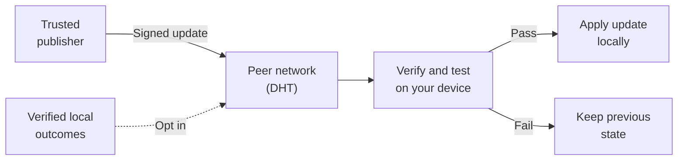

# Distributed updates and sharing

> [!NOTE]
> **Shared knowledge, local classification.** Armiger has an optional peer-to-peer system for receiving signed updates to its model adapters, confidence calibration and catalog. Your installation checks an update before using it locally. Contributing back is a separate choice and is **off by default**.

You can use Armiger without setting up this system. Start with the [quickstart](quickstart.md) for ordinary local classification.

## Why it helps

- **Reuse verified work.** Participating installations can contribute aggregated observations, so useful evidence can be shared across the community.
- **Update more than the model.** Supported updates can carry catalog corrections, confidence adjustments and small model-adapter changes, without retraining the base model on each device.
- **Keep control of your installation.** Choose trusted publishers, receive updates without contributing, and retain the previous state when an update fails verification or local regression checks.

The goal is to make shared improvements available locally. An update's effect on accuracy still needs to be measured; a signature or a passed regression check does not prove that it improves real-world results.

## How it works

The **DHT** (distributed hash table) is the peer network used to exchange update data. Your device decides whether to accept what it receives.



The solid arrows show **receiving an update**. The dotted arrow shows **contributing evidence**, only when sharing is enabled. Contributions do not automatically become trusted updates.

1. **Publish and discover.** A publisher signs an update; a configured installation obtains the manifest and payload through its update transport.
2. **Verify and test locally.** Armiger checks trusted signatures, payload hashes, version order, peer attestations and supported formats. Ultra stages the candidate and compares it with the current state on local regression checks.
3. **Apply or restore.** A candidate that passes can be committed locally. A rejected update leaves the current state in place; a staged candidate that regresses is rolled back.

## What can be shared

The subsystem supports three kinds of update:

- **Model-adapter changes:** small numerical adjustments to the adapter used alongside the base model.
- **Confidence calibration:** aggregate reliability information used to adjust confidence estimates and thresholds.
- **Catalog observations:** compact records with hashed keys and numerical fields, rather than raw release names or files.

When contributing, local outcomes must pass the relevant evidence checks. An unverified model prediction is not treated as ground truth. Outbound bundles pass through aggregation and payload filtering before signing and publication.

## Your sharing choices

**Receiving does not require contributing.** With `opt_in_sharing=False`, contribution exports and DHT publications are blocked. Local verification of supplied inbound bundles remains available. Receiving live updates still requires configured trust and a transport; the sharing flag alone does not set these up.

With no override, sharing resolves to `False`. To enable contributions, explicitly pass `opt_in_sharing=True`, or leave the argument unset and set `ARMIGER_DHT_SHARE_OPT_IN` to `1`, `true` or `yes`. An explicit `False` overrides the environment. Components also enforce their configured mode, such as `pull_only` or `off`.

Use `sharing_status()` to inspect the effective setting and outbound counters. For example, a fresh instance with sharing disabled includes these fields:

```json
{
  "opt_in_sharing_enabled": false,
  "outbound_bundles_shared": 0,
  "outbound_bytes_shared": 0,
  "ephemeral_pubkey_hex": null
}
```

**These are contribution controls.** DHT queries and downloads still involve network traffic. Payload filtering does not hide a participant's network address from peers, and the sharing setting does not govern other network features such as model downloads or provider lookups.

## Trust and limitations

Configure explicit trusted update authorities. A contributor's temporary signing key is not a trusted publisher key, and the constructor's placeholder root key does not establish trust. The v3 model release establishes `seq=3006` as its new trust root; earlier deterministic test authorities are retired. See the [signed release manifest](../benchmarks/receipts/dht_seq3006/signed_dht_manifest_seq3006.json). Do not copy test keys into a deployment.

Ultra's update path uses **baseline-relative regression checks**: it compares the candidate with the current installation and restores the previous state if the candidate gets worse on those checks. The shipped models do not pass the canary suite's absolute thresholds. These checks are not an absolute safety or accuracy qualification; see [evaluation limits](evaluation.md#limits).

<details>
<summary>Technical details and verification</summary>

### Default contribution protections

`AnonymityGuard` applies the following protections to exported weight, calibration and catalog bundles:

1. **Temporary signing identities.** By default, contribution sessions or epochs use fresh in-memory Ed25519 keys without embedding host metadata.
2. **Coarse timestamps.** Wire timestamps are rounded to hour boundaries, reducing timing detail in the payload.
3. **Aggregation and noise.** Exports require at least 25 samples. Weight deltas are clipped, receive Gaussian noise and are quantized to int8 under the default configuration.
4. **Hashed catalog keys.** Catalog keys use domain-separated, keyed BLAKE2b digests, represented as 16 hexadecimal characters.
5. **Payload inspection.** A strict schema and identifying-data filters reject raw titles, paths, URLs, passkeys, addresses, external IDs and other disallowed values before signing or transmission.

These protections reduce information in the shared payload. Rotating a key, rounding timestamps or hashing a record does not by itself establish sender anonymity or a formal privacy guarantee for an entire deployment.

### Code and checks

- [Update and contribution engine](../src/armiger/armiger_dht_rsi.py)
- [Catalog synchronization](../src/armiger/armiger_dht_db_sync.py)
- [Ultra update application and rollback](../src/armiger/armiger_ultra_pipeline.py)
- [Payload privacy guard](../src/armiger/dht_rsi_models_and_privacy.py)
- [Local UDP proof harness](../benchmarks/proof_anonymous_opt_in_sharing.py) and [sharing tests](../tests/test_anonymous_opt_in_dht_sharing.py)

From a development installation with the model bundle available, run:

```bash
python -m pytest -q tests/test_anonymous_opt_in_dht_sharing.py
```

The tests exercise default-disabled contributions, 500 adversarial payloads and a 12-node local UDP swarm. The convergence experiment uses synthetic data; its scores are not production accuracy results, and the local network test does not prove Internet-wide anonymity.

</details>
