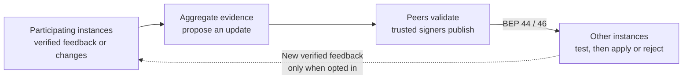

# Distributed updates and sharing

> [!NOTE]
> **Shared learning across Armiger instances.** Participating installations can contribute verified outcomes or candidate parameter changes. Aggregation, peer review and trusted signing turn supported contributions into updates that other installations test locally. Contributing is optional and **off by default**.

You can use Armiger without setting up this system. Start with the [quickstart](quickstart.md) for ordinary local classification.

## Why it helps

- **Let one installation's discoveries help others.** Verified feedback can support corrections for installations that have not seen the same evidence.
- **Learn from combined evidence.** Contributions can support catalog corrections, confidence adjustments and small model-adapter changes, without retraining the base model on each device.
- **Keep control of your installation.** Choose trusted publishers, receive updates without contributing, and retain the previous state when an update fails verification or local regression checks.

The goal is to make shared improvements available locally. An update's effect on accuracy still needs to be measured; a signature or a passed regression check does not prove that it improves real-world results.

## How it works

This is a feedback loop: participating instances supply evidence or candidate changes, an aggregator builds a proposed update, and other instances validate it before use. The **DHT** (distributed hash table) carries small update announcements; the larger update bundle is fetched separately. BEP 44 and BEP 46 explain this update-discovery pattern.



The dotted arrow closes the loop: a receiver can also contribute its own verified feedback when opted in. Receiving an update does not turn sharing on. Failed verification or a local regression leaves the receiver's previous state in place.

1. **Observe and contribute.** Opted-in instances submit verified outcomes, calibration feedback or candidate adapter/calibration changes. An unverified prediction is not treated as ground truth.
2. **Combine and learn.** Aggregators authenticate contributions and combine evidence into candidate catalog, calibration or adapter updates. A single contribution does not automatically become a published update.
3. **Review and publish.** Reviewing peers check the candidate against local verified records and regression checks. Trusted signers authorize an update for distribution.
4. **Test, apply and repeat.** Receivers check signatures, payload hashes, version order, attestations and formats, then test the candidate locally. Ultra commits a passing candidate or rolls back a regression. Further verified feedback can feed the next round.

### Where BEP 44 and BEP 46 fit

**BEP** means BitTorrent Enhancement Proposal. These two proposals describe update storage and discovery:

- **[BEP 44: signed DHT records](https://www.bittorrent.org/beps/bep_0044.html).** Its mutable items let a publisher update a small record at a stable lookup address. Ed25519 signatures authenticate the record, and increasing sequence numbers distinguish newer announcements from older ones. This is the small “an update is available” record, rather than the model weights themselves.
- **[BEP 46: finding the current torrent](https://www.bittorrent.org/beps/bep_0046.html).** It builds on BEP 44 by putting a torrent's infohash in that mutable record. Subscribers following the publisher's public key and optional salt can discover which torrent currently carries the content, then fetch that content separately.

Armiger adds the learning-specific layer: contribution validation, aggregation, trusted signers, payload hashes and local regression checks. BEP 44 and BEP 46 do not decide whether a model change improves accuracy. The diagram labels this discovery layer; see **Protocol implementation scope** in the expandable technical reference below for the local test transport's limits.

### How improvements are evaluated

An instance can contribute verified evidence or candidate changes without first proving that its overall accuracy is higher than other instances. The resulting update is what gets evaluated. For example, calibration fitting looks for lower prediction loss on contributed evidence; reviewing peers compare a candidate with their own current state. The current implementation does not automatically rank instances by reported accuracy and publish the winner's model.

## What can be shared

The subsystem supports three kinds of update:

- **Model-adapter changes:** small numerical adjustments to the adapter used alongside the base model.
- **Confidence calibration:** aggregate reliability information used to adjust confidence estimates and thresholds.
- **Catalog observations:** compact records with hashed keys and numerical fields, rather than raw release names or files.

Local outcomes must pass the relevant evidence checks. The encrypted RSI feedback path can submit individual verified observations to a configured aggregator; other APIs export aggregate parameter or catalog bundles. Contributions still need validation before they can support a trusted update.

## Your sharing choices

**Receiving does not require contributing.** With `opt_in_sharing=False`, contribution exports and DHT publications are blocked. Local verification of supplied inbound bundles remains available. Receiving live updates still requires configured trust and a transport; the sharing flag alone does not set these up.

With no override, sharing resolves to `False`. To enable contributions, explicitly pass `opt_in_sharing=True`, or leave the argument unset and set `ARMIGER_DHT_SHARE_OPT_IN` to `1`, `true` or `yes`. An explicit `False` overrides the environment. Components also enforce their configured mode, such as `pull_only` or `off`.

Use `sharing_status()` to inspect the effective setting and outbound counters. For example, a fresh instance with sharing disabled includes these fields:

```json
{
  "opt_in_sharing_enabled": false,
  "outbound_bundles_shared": 0,
  "outbound_bytes_shared": 0,
  "ephemeral_pubkey_hex": null
}
```

**These are contribution controls.** DHT queries and downloads still involve network traffic. Payload filtering does not hide a participant's network address from peers, and the sharing setting does not govern other network features such as model downloads or provider lookups.

## Trust and limitations

Configure explicit trusted update authorities. A contributor's temporary signing key is not a trusted publisher key, and the constructor's placeholder root key does not establish trust. The v3 model release establishes `seq=3006` as its new trust root; earlier deterministic test authorities are retired. See the [signed release manifest](../benchmarks/receipts/dht_seq3006/signed_dht_manifest_seq3006.json). Do not copy test keys into a deployment.

Ultra's update path uses **baseline-relative regression checks**: it compares the candidate with the current installation and restores the previous state if the candidate gets worse on those checks. The shipped models do not pass the canary suite's absolute thresholds. These checks are not an absolute safety or accuracy qualification; see [evaluation limits](evaluation.md#limits).

<details>
<summary>Technical details and verification</summary>

### Protocol implementation scope

Armiger uses the small signed announcement plus separate bundle pattern, with its own manifests and payload schemas. These application formats extend beyond the BEPs.

The [local wire harness](../tests/bep44_udp_wire_harness.py) implements BEP 44 mutable `get`/`put` operations and uses custom `put_bundle`/`get_bundle` UDP messages for larger bundles. Those custom messages are not defined by BEP 46. The [update bridge's `sign_manifest()` contract](../src/armiger/ultra_pipeline_update_bridge.py) also leaves BEP 46 mutable-item target derivation out of scope and uses SHA-1 of the payload as its content identifier. That identifier is not, by itself, a generated torrent's infohash.

The protocol references explain the design and discovery roles. Local harness results do not establish interoperability with arbitrary BEP 46 torrent clients.

### Default contribution protections

`AnonymityGuard` applies the following protections through its guarded aggregate weight, calibration and catalog export APIs:

1. **Temporary signing identities.** By default, contribution sessions or epochs use fresh in-memory Ed25519 keys without embedding host metadata.
2. **Coarse timestamps.** Wire timestamps are rounded to hour boundaries, reducing timing detail in the payload.
3. **Aggregation and noise.** Exports require at least 25 samples. Weight deltas are clipped, receive Gaussian noise and are quantized to int8 under the default configuration.
4. **Hashed catalog keys.** Catalog keys use domain-separated, keyed BLAKE2b digests, represented as 16 hexadecimal characters.
5. **Payload inspection.** A strict schema and identifying-data filters reject raw titles, paths, URLs, passkeys, addresses, external IDs and other disallowed values before signing or transmission.

These protections reduce information in the shared payload. Rotating a key, rounding timestamps or hashing a record does not by itself establish sender anonymity or a formal privacy guarantee for an entire deployment.

Encrypted RSI feedback (`export_rsi_telemetry_bundle`) is a separate format and can contain individual verified observations. Do not assume the guarded aggregate format's 25-sample minimum or keyed catalog hashing describes every encrypted feedback field; that API has its own metadata and dispatch-scheduling contract.

### Code and checks

- [Update and contribution engine](../src/armiger/armiger_dht_rsi.py)
- [Catalog synchronization](../src/armiger/armiger_dht_db_sync.py)
- [Ultra update application and rollback](../src/armiger/armiger_ultra_pipeline.py)
- [Feedback aggregation, calibration fitting and adapter training](../src/armiger/ultra_pipeline_update_bridge.py)
- [Continuous parameter-delta aggregation](../src/armiger/dht_rsi_canary_and_agg.py)
- [Payload privacy guard](../src/armiger/dht_rsi_models_and_privacy.py)
- [Local UDP proof harness](../benchmarks/proof_anonymous_opt_in_sharing.py) and [sharing tests](../tests/test_anonymous_opt_in_dht_sharing.py)
- [Multi-instance knowledge-transfer and rollback tests](../tests/test_distributed_knowledge_transfer.py)

From a development installation with the model bundle available, run:

```bash
python -m pytest -q tests/test_anonymous_opt_in_dht_sharing.py tests/test_distributed_knowledge_transfer.py
```

The tests exercise default-disabled contributions, 500 adversarial payloads and a 12-node local UDP swarm. The convergence experiment uses synthetic data; its scores are not production accuracy results, and the local network test does not prove Internet-wide anonymity.

The multi-instance tests also exercise verified feedback becoming a signed update, another instance using the resulting catalog/calibration/adapter changes, and rollback of a poisoned candidate. These controlled tests establish the transfer mechanism, not fleet-wide accuracy gains.

</details>
