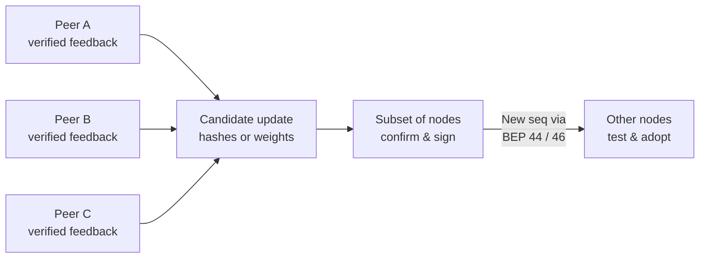

# Distributed updates and sharing

> [!NOTE]
> **Shared plugin updates across Armiger instances.** Participating nodes can contribute verified feedback on the catalog hashes, calibration temperatures and residual-adapter weights used by Armiger's plugins. When a candidate improvement is confirmed across a subset of independent nodes and signed as a new sequence version, other installations can discover it over the DHT, test it locally and adopt it. Contributing is optional and **off by default**.

Normal classification runs locally and never sends feedback or fetches updates on its own. You can use Armiger without this subsystem—start with the [quickstart](quickstart.md) for ordinary local classification. Both contributing feedback and receiving updates require explicit configuration: enabling opt-in and calling the export APIs to contribute, or pinning trusted signers and peer attestors and supplying a transport to receive updates.

## The Problem

A static local classifier falls behind in three ways:

- **New titles outpace the shipped catalog.** Bare or minimally tagged releases for newly released movies and series are absent from the offline title catalog until verified examples are observed.
- **Swarm traps and tracker conditions shift.** Fake-seeder honeypots and masquerading executables adapt faster than full base-model releases.
- **No single node sees enough verified imports.** One installation rarely downloads and verifies enough diverse media to recalibrate confidence thresholds or refit adapter weights safely on its own, and retraining or redistributing the full base neural model for incremental updates is impractical.

## The Solution

Instead of retraining the base neural model on each device, participating nodes share evidence and candidate updates for the **lightweight plugin files** that run alongside the base model:

- **Catalog hash additions:** compact 16-hex-character `BLAKE2b-64` hashes of normalized `title|year` strings mapped to `movie` or `tv_show` so bare release names resolve without retraining.
- **Confidence calibration:** per-head temperature scalars and logit-bias adjustments that align confidence estimates with verified outcomes.
- **Residual-adapter weights:** small numerical adjustments to the 3 trainable junk-path tensors of the swarm residual adapter (or a full validated model bundle).

Contributions use two export paths depending on the workflow:

- **Encrypted per-import feedback:** sent after a physically verified download, carrying an anonymized outcome record, a temperature loss profile, swarm anomaly features, and (by default for verified clean movies and series) a shared catalog hash so other nodes can match the same normalized `title|year` locally. Callers can disable catalog-hash export per call.
- **Guarded aggregate deltas:** exported only after accumulating at least 25 local samples, clipping and adding noise to quantized weight deltas, and using per-instance keyed hashes for standalone catalog records.

To prevent bad predictions or Sybil nodes from poisoning the fleet, candidate updates are built only from physically verified imports and **must be confirmed across a subset of independent nodes** (and co-signed by pinned release authorities) before being promoted as a new version. Every receiving node still tests a promoted version against its own local baseline and rolls back automatically on regression.

## How it works

Opted-in peers contribute verified observations or weight deltas, cross-peer agreement forms a candidate plugin update, a quorum of independent peer nodes confirms the candidate against their own verified records and canary suite, and the confirmed update is promoted as a new sequence number (`seq`) via **BEP 44 / BEP 46** for other nodes to verify and adopt.



Receiving an update never turns outbound sharing on; only nodes with `opt_in_sharing=True` export feedback into future rounds.

1. **Peers contribute verified feedback.** Contributions happen only when an opted-in installation calls a feedback or export API—never automatically during classification. Local observations must pass physical verification (completed download, decodable media streams and catalog provenance) so unverified model predictions are never exported as ground truth.
2. **Cross-peer evidence forms a candidate update.** Aggregators combine authenticated peer submissions: requiring multi-node agreement before adding a catalog hash, selecting calibration temperatures that lower prediction loss relative to unscaled scores, fitting small swarm-adapter weight deltas across contributed swarm outcomes, or taking a per-network trimmed mean of submitted weight deltas.
3. **A subset of nodes confirms and promotes the version.** Independent reviewing peers across distinct networks (`>= 5` ASNs) compare the candidate against their own verified local records (rejecting contradicted or unconfirmed catalog keys and worse calibration loss) and stage it against their 500-item canary baseline. Once the peer quorum attests that the candidate passes and threshold signers co-sign the manifest, the update is published as the next monotonic `seq` version.
4. **Other nodes discover, test and adopt (or roll back).** Subscribing nodes discover the new `seq` announcement via BEP 44/46, fetch the bundle, verify the threshold signatures and distinct-ASN peer attestations, and stage the update against their own pre-update canary baseline and verified local records. Passing updates are adopted (including newly discovered catalog hashes); any local regression rolls back to the exact prior state.

Nodes are never ranked against one another to copy a single "winning" node's model; candidate plugin updates are synthesized from multi-node evidence and confirmed against each reviewing and receiving node's local baseline.

### Where BEP 44 and BEP 46 fit

**BEP** means BitTorrent Enhancement Proposal. These two specifications describe how nodes publish and discover the latest version pointer in the **DHT** (distributed hash table):

- **[BEP 44: signed DHT records](https://www.bittorrent.org/beps/bep_0044.html).** Mutable items store a small signed record (`<= 1000` bytes) at a lookup target derived from a public key and optional salt, using increasing sequence numbers (`seq`) and optional compare-and-swap checks to order versions. This carries the compact version announcement rather than large weight files.
- **[BEP 46: updating torrents via DHT mutable items](https://www.bittorrent.org/beps/bep_0046.html).** Places a target torrent's 20-byte infohash inside a BEP 44 mutable record discovered via a public-key magnet link, so subscribers can discover which content hash carries the current version and fetch the payload separately.

BEP 44 and BEP 46 handle version discovery; Armiger defines the plugin update manifests, distinct-ASN peer attestations, payload schemas and local regression gates. See **Protocol implementation scope** in the expandable reference below for how Armiger's manifest hashes and local UDP test harness differ from standard BEP 46 torrent transport.

## Your sharing choices

**Receiving does not require contributing.** With `opt_in_sharing=False` (the default), contribution exports and DHT publications are blocked, while local verification and adoption of supplied inbound bundles remain available.

With no override, sharing resolves to `False`. To enable contributions, pass `opt_in_sharing=True` explicitly, or leave the argument unset and set `ARMIGER_DHT_SHARE_OPT_IN` to `1`, `true` or `yes`. An explicit `False` overrides the environment. Components also enforce their configured mode, such as `pull_only` or `off`.

Use `sharing_status()` to inspect the active setting and outbound counters:

```json
{
  "opt_in_sharing_enabled": false,
  "outbound_bundles_shared": 0,
  "outbound_packets_blocked_opt_out": 0,
  "outbound_bytes_shared": 0,
  "ephemeral_pubkey_hex": null
}
```

**These are contribution controls, not network-layer anonymity.** DHT queries and bundle transfers still expose a participant's network address to peers unless routed through an external anonymizing transport, and `opt_in_sharing` does not govern model downloads or external provider lookups.

## Trust and limitations

Promoting and accepting a new `seq` version is **federated and quorum-gated, not permissionless**: because an open DHT allows Sybil attackers to spin up arbitrary node identities, receivers reject all updates until trusted federation signers (`M-of-N`) and registered peer attestors (`K-of-N` across distinct ASNs) are explicitly configured out-of-band. Neither a contributor's temporary signing key nor the constructor's all-zero placeholder root key establishes trust.

The v3.0.0 release establishes `seq=3006` as its offline release checkpoint and retires earlier deterministic test keys; see the [signed release manifest](../benchmarks/receipts/dht_seq3006/signed_dht_manifest_seq3006.json) and [release receipt](../benchmarks/receipts/dht_seq3006/dht_release_v3_gold_mit3_receipt.json). That receipt records a single-authority release (`quorum_attestations=0`) rather than a peer-attested runtime update bundle. Do not copy test keys into a deployment.

Ultra's update path uses **baseline-relative regression checks**: it compares the staged candidate with the receiver's pre-update state and restores the previous state if canary metrics or locally verified records regress. Shipped models do not pass the 500-item canary suite's absolute thresholds; see [evaluation limits](evaluation.md#limits).

<details>
<summary>Technical details and verification</summary>

### Protocol implementation scope

Armiger follows the BEP 44/46 discovery pattern—a small signed mutable pointer announcing a sequence number and content hash, with the bundle transferred out-of-band—while using application-specific manifests (`ThresholdDHTManifest`, `SignedDHTManifest`, `DHTShardManifest`) and payload schemas (`armiger-dht-update-v1`).

Concrete differences between the BEP specifications, the update bridge and the local test harness:

- **Manifest `infohash` field:** In [`RSIUpdateAggregator.sign_manifest()`](../src/armiger/ultra_pipeline_update_bridge.py), `infohash` defaults to `SHA-1(payload_bytes)` (and in `ByzantineResilientAggregator._sign_bep46_bundle()`, `SHA-1("armiger-bep46-seq-<seq>:<bundle_sha256>")`). Unlike BEP 46, neither constructs a `.torrent` `info` dictionary or derives a BEP 44 `SHA-1(pubkey || salt)` lookup target.
- **Local UDP wire harness ([`tests/bep44_udp_wire_harness.py`](../tests/bep44_udp_wire_harness.py)):** Implements BEP 44 mutable `get`/`put` over localhost UDP (`target = SHA-1(k || salt)`, canonical signing buffer `[4:salt<len>:<salt>]3:seqi<seq>e1:v<len>:<v>`, 1000-byte limit on `v`, monotonic `seq` error `302`, and `cas` mismatch error `301`). However, it stores a UTF-8 JSON pointer (`{"ih": ..., "merkle_root": ..., "seq": ..., "sha256": ..., "shard_id": ...}`) in `v` instead of a BEP 46 bencoded dictionary `{"ih": <20-byte binary torrent infohash>}`, transfers 4 KiB payload slices via custom `put_bundle`/`get_bundle` UDP RPCs instead of BitTorrent peer wire protocol, omits BEP 44 `get` write tokens (`token`), and returns error `301` (rather than BEP 44's `206`) on invalid Ed25519 signatures.
- **Release receipt vs. runtime update bundles:** [`signed_dht_manifest_seq3006.json`](../benchmarks/receipts/dht_seq3006/signed_dht_manifest_seq3006.json) binds the v3.0.0 release (`seq=3006`, `quorum_attestations=0`) under a single offline Ed25519 authority while storing its Height-10 `XMSS-SHAKE256` signature in [`full_model_release_pointer_v3_gold_mit3_seq3006.json`](../benchmarks/receipts/dht_seq3006/full_model_release_pointer_v3_gold_mit3_seq3006.json). By contrast, `ArmigerUltraPipeline.stage_and_apply_dht_update` requires an M-of-N `ThresholdDHTManifest` (`Ed25519` + `WOTS+-SHAKE256`) plus K-of-N distinct-ASN `PeerAttestation`s, and `ArmigerDHTUpdater.verify_bundle` requires `quorum_attestations >= min_quorum` and an inline `pq_signature_hex` or `xmss_signature_hex`.

Local harness results verify wire serialization, signature checking and chunk reassembly; they do not establish interoperability with arbitrary Mainline DHT or BEP 46 BitTorrent clients.

### Triggers, aggregation and acceptance mechanics

- **Contribution triggers and physical verification:** `export_rsi_telemetry_bundle` and `ingest_rsi_feedback` require `opt_in_sharing=True`, `rsi_mode="anonymous_contribute"`, and a `CandidateObservation` that passes `PhysicalGroundTruthVerifier.verify_observation` (`download_progress >= 1.0`, valid `ffprobe` streams/duration, and catalog ID provenance for clean media). Unverified predictions are rejected (`unverified_circular_self_training_rejected`).
- **Closed-loop Ultra aggregator (`RSIUpdateAggregator` in [`ultra_pipeline_update_bridge.py`](../src/armiger/ultra_pipeline_update_bridge.py)):**
  - `build_zero_cue_delta(min_support=3)`: emits a `movie_add` or `tv_add` entry only when at least 3 distinct authenticated voters (`asn:<asn>` or `pk:<pubkey>`) unanimously report the same category; conflicting keys are dropped.
  - `fit_calibration_delta(min_samples=8, min_rel_improvement=0.02)`: averages contributors' per-head `NLL(T)` profiles across the 19-point temperature grid (`0.50`–`4.00`) and selects `argmin T` when mean `NLL` improves by at least `2%` over `T = 1.0`.
  - `train_swarm_adapter_delta(min_samples=20, steps=300, lr=0.05, l2=1e-3)`: runs 300 Adam steps on a copy of `SwarmResidualAdapter`, updating only `("junk_gate.bias", "head_scales.junk", "junk_encoder.4.weight")` when at least 20 verified samples containing both clean and junk swarms are present, and exports the additive `float32` diff as SafeTensors (`swarm_adapter_safetensors_delta`).
  - **Single-process vs. multi-host contributor trust:** `export_rsi_telemetry_bundle` auto-registers the contributor's ephemeral Ed25519 key in the in-process dictionary `AuthoritativeASNVerifier._GLOBAL_PINNED_PUBKEY_ASN`, satisfying `RSIUpdateAggregator(require_trusted_contributor=True)` inside single-process tests. Multi-host deployments must register contributor keys and ASNs explicitly on the aggregator via `register_contributor(pubkey_hex, asn)`.
- **Byzantine continuous and catalog aggregator (`ByzantineResilientAggregator` in [`dht_rsi_canary_and_agg.py`](../src/armiger/dht_rsi_canary_and_agg.py)):**
  - `aggregate_catalog_observations`: requires `>= 5` distinct ASNs, `>= 10` observations, matching `ffprobe` stream signatures and `>= 90%` category agreement (both by observation share and 1-vote-per-ASN share).
  - `aggregate_continuous_deltas`: collapses multiple submissions from the same ASN by coordinate-wise median (one vote per ASN), clips coordinates beyond `6 * MAD` from the cross-ASN median, and takes a `20%` symmetric trimmed mean across `>= 5` distinct ASNs.
- **Peer attestation vs. receiver application:**
  - **Reviewing peers (`evaluate_dht_update_payload` / `attest_dht_update`):** with `require_ledger_confirmation=True` (default), a reviewing peer compares every key in `zero_cue_catalog_delta` against its own `_verified_ledger`, rejecting both contradicted keys and **unconfirmed** keys absent from its ledger, and requires `calibration_delta` not to worsen `NLL` on that ledger before staging and rolling back against the 500-item canary baseline (`bare_title` and `file_tree_swarm` views).
  - **Receivers (`configure_dht_update_trust` + `stage_and_apply_dht_update`):** verify M-of-N `ThresholdDHTManifest` signatures (`ThresholdSignatureVerifier`), `SHA-256(payload_bytes)`, K-of-N distinct-ASN `PeerAttestation`s (`SybilQuorumVerifier`) and `SafeFormatValidator`, then compare staged canary metrics and any existing `_verified_ledger` items against the receiver's pre-update baseline (`max_category_regression=0.005`, `max_scope_regression=0.005`, zero new safety/honeypot leaks, zero ledger label flips). Unlike reviewing peers, receivers accept unconfirmed catalog keys so new title mappings can transfer across instances.

### Default contribution protections

`AnonymityGuard` and `TelemetryAnonymizer` ([`dht_rsi_models_and_privacy.py`](../src/armiger/dht_rsi_models_and_privacy.py)) apply five payload controls:

1. **Temporary signing identities.** By default, sessions or epochs generate fresh in-memory Ed25519 keys without embedding host metadata.
2. **Coarse timestamps and noisy metrics.** Wire timestamps are bucketed to UTC hours (`3600s`), and `TelemetryAnonymizer` adds bounded `log2` Laplace noise to file sizes and durations.
3. **Aggregation and noise on delta exports.** `AnonymityGuard` requires at least `min_k_samples=25` samples, clips weight deltas to L2 norm `1.0`, adds Gaussian noise (`sigma = 0.05`) and quantizes to `int8`.
4. **Catalog key hashing (`armiger-catalog-v1` vs. `armiger-catalog-v2`).** Standalone catalog records built via `AnonymityGuard.build_anonymous_catalog_record` use per-instance **keyed** 16-hex-char `BLAKE2b-64` digests (`armiger-catalog-v2`). By contrast, `export_rsi_telemetry_bundle` (when `include_catalog_key=True`, the default for verified clean `movie`/`tv_show` imports) and `zero_cue_catalog_delta` use **unkeyed** `BLAKE2b-64("armiger-catalog-v1:" + norm)` from `zero_cue_plugin.hash_catalog_key` so receivers can compute the same digest during `lookup_zero_cue_catalog`. Anyone holding a candidate title list can test membership against `armiger-catalog-v1` digests; pass `include_catalog_key=False` to omit the catalog key.
5. **Payload inspection.** Schema and regex filters reject raw titles, file paths, URLs, tracker passkeys, IP/MAC/email addresses and raw external catalog IDs before signing or encryption.

These controls limit payload contents; they do not hide network addresses or provide a formal end-to-end anonymity guarantee across an entire deployment.

### Code and checks

- [Update and contribution engine (`armiger_dht_rsi.py`)](../src/armiger/armiger_dht_rsi.py)
- [Catalog shard synchronization (`armiger_dht_db_sync.py`)](../src/armiger/armiger_dht_db_sync.py)
- [Ultra update application and rollback (`armiger_ultra_pipeline.py`)](../src/armiger/armiger_ultra_pipeline.py)
- [Feedback aggregation, calibration fitting and adapter training (`ultra_pipeline_update_bridge.py`)](../src/armiger/ultra_pipeline_update_bridge.py)
- [Byzantine parameter-delta and catalog aggregation (`dht_rsi_canary_and_agg.py`)](../src/armiger/dht_rsi_canary_and_agg.py)
- [Payload privacy guard and physical verifier (`dht_rsi_models_and_privacy.py`)](../src/armiger/dht_rsi_models_and_privacy.py)
- [Single-root `ArmigerDHTUpdater` and XMSS verifier (`calibration_and_dht.py`)](../src/armiger/calibration_and_dht.py)
- [Local UDP proof harness (`proof_anonymous_opt_in_sharing.py`)](../benchmarks/proof_anonymous_opt_in_sharing.py) and [sharing tests (`test_anonymous_opt_in_dht_sharing.py`)](../tests/test_anonymous_opt_in_dht_sharing.py)
- [Multi-instance knowledge-transfer and rollback tests (`test_distributed_knowledge_transfer.py`)](../tests/test_distributed_knowledge_transfer.py)

From a development installation with the model bundle available, run:

```bash
python -m pytest -q tests/test_anonymous_opt_in_dht_sharing.py tests/test_distributed_knowledge_transfer.py
```

What these suites verify—and their boundaries:

- **`test_anonymous_opt_in_dht_sharing.py`:** exercises default-off zero egress, rejection of 500 synthetic PII-bearing payloads, a 12-node localhost UDP swarm, and a 5-round synthetic linear-head convergence simulation (`58.5%` to `95.5%` on synthetic Gaussian features, not production torrent data).
- **`test_distributed_knowledge_transfer.py`:** exercises four multi-instance `ArmigerUltraPipeline` workflows:
  1. **Zero-cue catalog transfer (`test_1_zero_cue_knowledge_transfers_from_instance_a_to_instance_b`):** 6 contributor instances across distinct ASNs import 5 bare-title 2026 series plus 1 control title (while 1 contributor also exports a single-instance decoy). `build_zero_cue_delta(min_support=5)` accepts the 6 consensus keys and drops the single-instance decoy; after 6 peer attestations and 2-of-3 manifest signing, receiver `instance_b` improves from `0/5` to `5/5` on the bare-title series while preserving its high-confidence (`>= 0.88`) neural backbone prediction on the control item and rejecting a replayed `seq=1` update.
  2. **Calibration and swarm adapter transfer (`test_2_calibration_and_swarm_adapter_delta_transfer`):** 6 peers export 126 verified bundles (90 clean media, 36 masquerading-executable junk swarms). Starting from a legacy `1.225` category temperature (noting that the shipped v3 calibration is already within the default `2%` improvement gate on this cohort, so the test falls back to `min_rel_improvement=0.0` after verifying `improvement_below_threshold`), `fit_calibration_delta` and 300-step `train_swarm_adapter_delta` (`bce_after < bce_before`) produce a combined update that lowers held-out `category` `NLL` on `instance_b`. Held-out trap AUROC is non-regressing (`auroc_after >= auroc_before`) because `SwarmResidualAdapter` scales its residual by neural backbone junk uncertainty (clamped at `0.02` for confident-clean content).
  3. **Poisoned update rollback and pre-staging guards (`test_3_poisoned_weight_updates_roll_back_with_identical_predictions`):** verifies that even when compromised signers and attestors sign 4 poisoned calibration/adapter payloads, `golden_canary_non_regression` rolls back all 4 with bit-identical `dht_state_fingerprint()` and `classify_batch()` predictions (while an honest peer refuses to attest), and verifies pre-staging rejection of tampered payloads, 1-of-3 signatures, unpinned WOTS+ keys, `< 5` ASNs, unregistered Sybil attestors, `expected_prev_seq` CAS mismatches, smuggled `golden_canary_override` fields, pickle bytecode in SafeTensors and `NaN` adapter tensors.
  4. **Scoped telemetry masks (`test_4_scoped_telemetry_masks_and_file_count_parity`):** verifies `file_count` feature parity when `len(files) > 64` and confirms that a `qbittorrent` completion + `ffprobe` without an external catalog ID sets `evidence_masks["category"] = False` and omits both `zero_cue_catalog_key` and `calibration_nll_profile` from the exported telemetry bundle.

</details>
