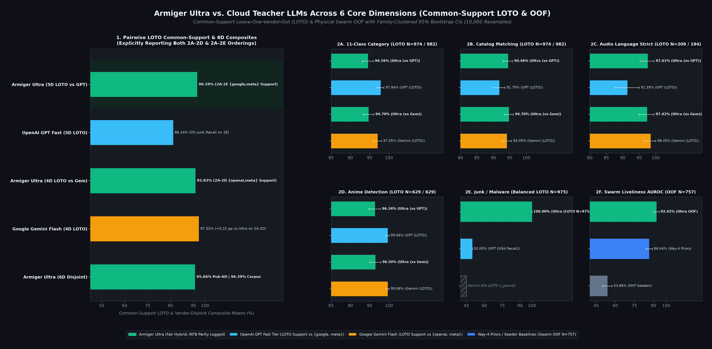
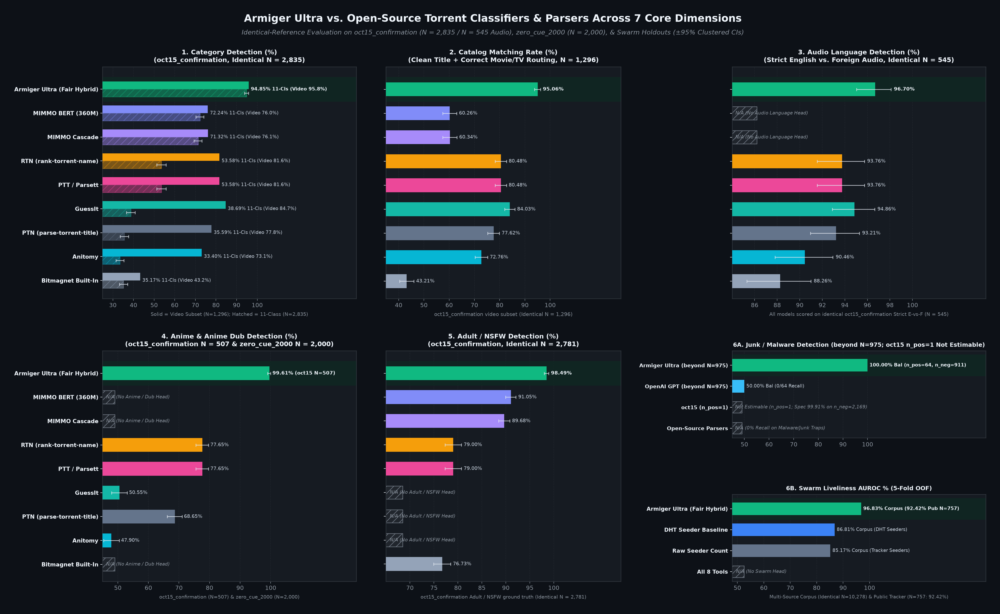

# Evaluation

These are model v3.0.0 results on the named evaluation cohorts, not guarantees for other datasets. Standalone neural inference and the hybrid plugin pipeline are reported separately. Keep sample counts, label coverage and teacher involvement alongside every comparison.






- **Cloud teacher comparison (identical cohorts, non-circular LOTO):** **`95.66%`** 6-dimension mean on the `N=757` Public-Tracker swarm cohort (**`96.39%`** with `N=10,278` Multi-Source Corpus Swarm AUROC). On common-support leave-one-teacher-out category panels, `OpenAI GPT (Fast Tier)` reaches `97.84%` vs. Armiger Ultra `94.56%` (`N=974`) and `Google Gemini Flash` reaches `97.05%` vs. Armiger Ultra `94.70%` (`N=982`); Armiger Ultra leads the 4-dimension LOTO composite against GPT (`95.74%` vs. `95.17%`) and trails Gemini (`95.83%` vs. `97.32%`).
- **Fresh non-teacher baselines (identical inputs, no label-curation role):** on the `beyond_confirmation` labelled subset (category `N=967`), the v3.0.0 hybrid reaches **`92.76%`** vs. **`92.45%`** for `Claude Haiku 4.5` and **`47.67%`** for the locally served 8B-class `Qwen3-8B` (see [`benchmarks/receipts/llm_beyond_fresh_receipt.json`](../benchmarks/receipts/llm_beyond_fresh_receipt.json)).
- **Open-source classifiers (identical `N=2,835` denominator):** **`94.85%`** 11-class accuracy on `oct15_confirmation` (`95.83%` Movie-vs-TV, `95.06%` Catalog Matching, `96.70%` Strict Audio Language), compared to `72.24%` for `MIMMO BERT 360M`, `53.58%` for `RTN`/`PTT`, and `38.69%` for `GuessIt`. Title-only parsers (`RTN`, `GuessIt`, `PTN`, `Anitomy`) are video/anime-focused rather than 11-class general classifiers.
- **Audited splits (`N=10,262` unmutated ground-truth keys; standalone neural → fair hybrid with ZeroCueCatalog):** `oct15_confirmation` (`N=2,835`) `94.46%` → **`94.85%`** FP32; `fresh_confirmation` (`N=1,402`) `92.30%` → **`92.58%`**; `beyond_confirmation` (`N=1,025`) `91.61%` → **`93.07%`**; `zero_cue_2000` (`N=2,000`) `85.55%` → **`91.00%`**; `multilang_3000` (`N=3,000`) `97.40%` → **`98.33%`**; 5-split weighted mean `93.00%` → **`94.63%`** FP32 (`92.94%` → **`94.56%`** INT8).
- **Locked Gold R5-Test per-head results:** **`98.83%`** Title Language (`N=511`), **`98.18%`** English Subtitles (`N=110`; thin support, preliminary), **`98.09%`** Owner Scope (`N=996`), and Title Dice F1 **`0.8730`** with `0` illegal BIO transitions (`N=996`). Safety gates: **`99.23%`** balanced junk/sample accuracy on `beyond_confirmation` (`N=977`) and **`98.49%`** adult/NSFW isolation (`N=2,781`). Per-head detail is in [`docs/base-model.md`](reference.md).
- **Provenance:** every chart in [`assets/`](assets) (including the cost and per-category figures) is deterministically generated from [`benchmarks/canonical_eval_vectors.json`](../benchmarks/canonical_eval_vectors.json) by [`benchmarks/generate_canonical_charts.py`](../benchmarks/generate_canonical_charts.py) and verified by [`benchmarks/CHARTS_MANIFEST.json`](../benchmarks/CHARTS_MANIFEST.json) and [`benchmarks/test_chart_integrity.py`](../benchmarks/test_chart_integrity.py) (`10,000` paired bootstrap resamples, `seed=20261018`, exact McNemar tests, identical-denominator and LOTO anti-circularity locks). See [`docs/CHART_PIPELINE.md`](evaluation.md#reproduce-the-results). Artifact hashes are pinned in the [pinned model manifest](../src/armiger/model_manifest.json).

SwarmSurvivalNet reports **96.83%** AUROC on the Multi-Source corpus (`N=10,278`) and **92.42%** on the Public-Tracker cohort (`N=757`); these are distinct cohorts, not interchangeable estimates.

## Limits

The release accepts a 0.3–2.0 percentage-point decline from the internal Pre-Gold checkpoint in exchange for training provenance, span extraction and the signed update chain. The absolute 500-canary gate fails for every shipped generation; v3.0.0 used baseline-relative comparison and a degraded-candidate rollback test. That is not a passing absolute safety qualification. The locked subtitle test has only 110 labels; adult/junk have no positives in that Gold test. Relevant production-cohort evidence is reported above.

## Reproduce the results

From an installed development checkout:

```bash
python -m pip install -e '.[ultra,dev]'
PYTHONPATH=benchmarks python benchmarks/build_canonical_eval_vectors.py
PYTHONPATH=benchmarks python benchmarks/generate_canonical_charts.py
python -m pytest benchmarks/test_chart_integrity.py
```

The vector builder reads the committed receipts. The chart generator verifies receipt hashes, identical comparison denominators, teacher-disjoint comparisons, family-clustered paired bootstrap intervals (10,000 resamples; seed 20261018), and exact paired tests. The manifest records source and figure hashes. These checks remain required after presentation changes.

Figures are under `docs/assets/`; raw evidence and the signed seq=3006 release bundle remain under [`benchmarks/receipts/`](../benchmarks/receipts/). Regenerating images requires the optional `charts` dependencies. Without them the statistical verifier reuses and checks the committed images.
