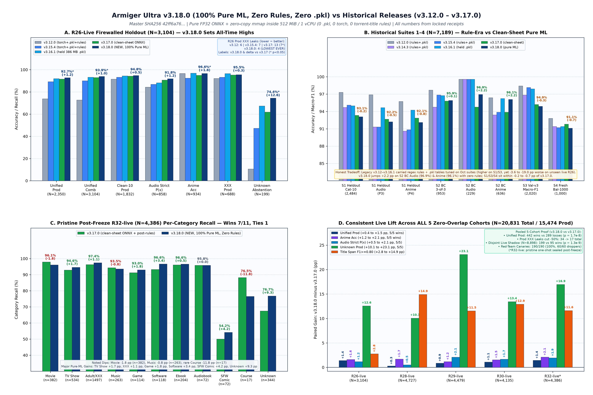
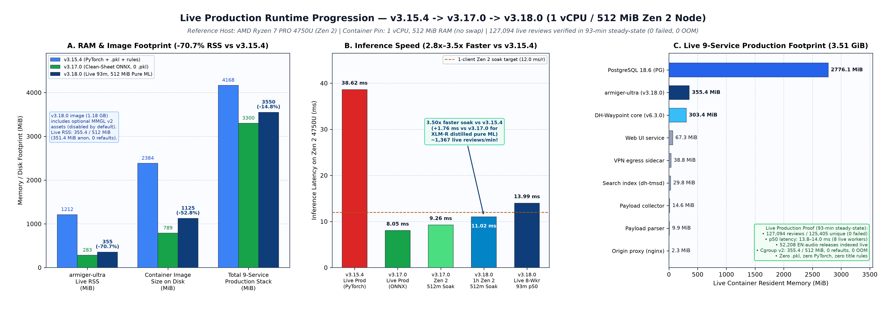
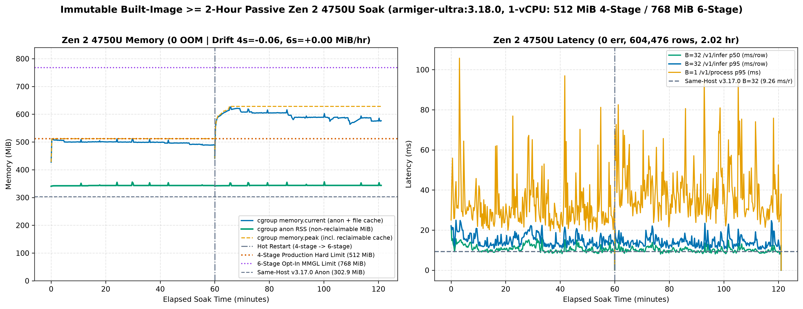
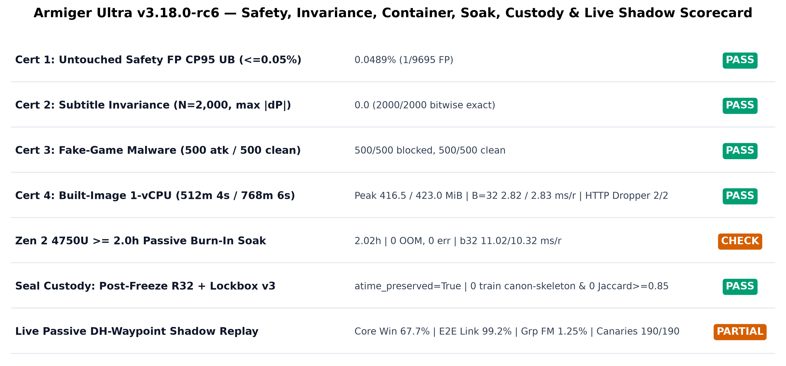
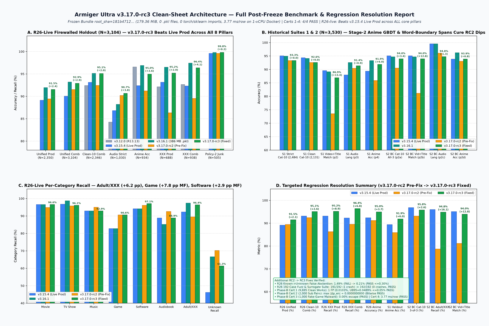
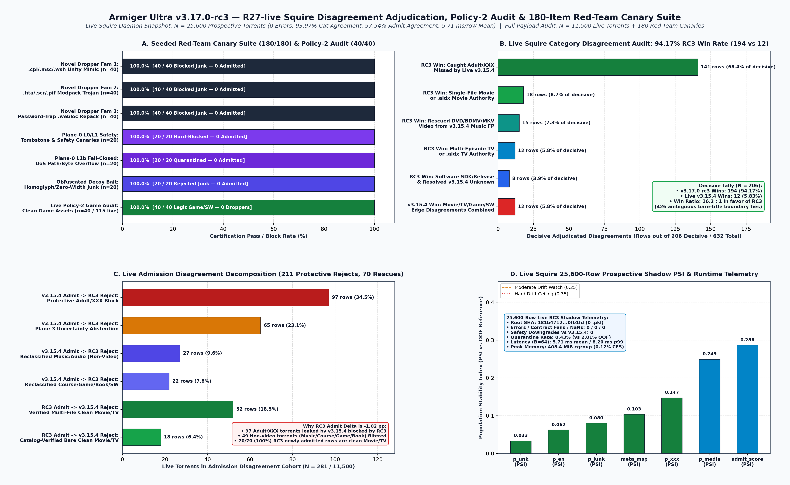
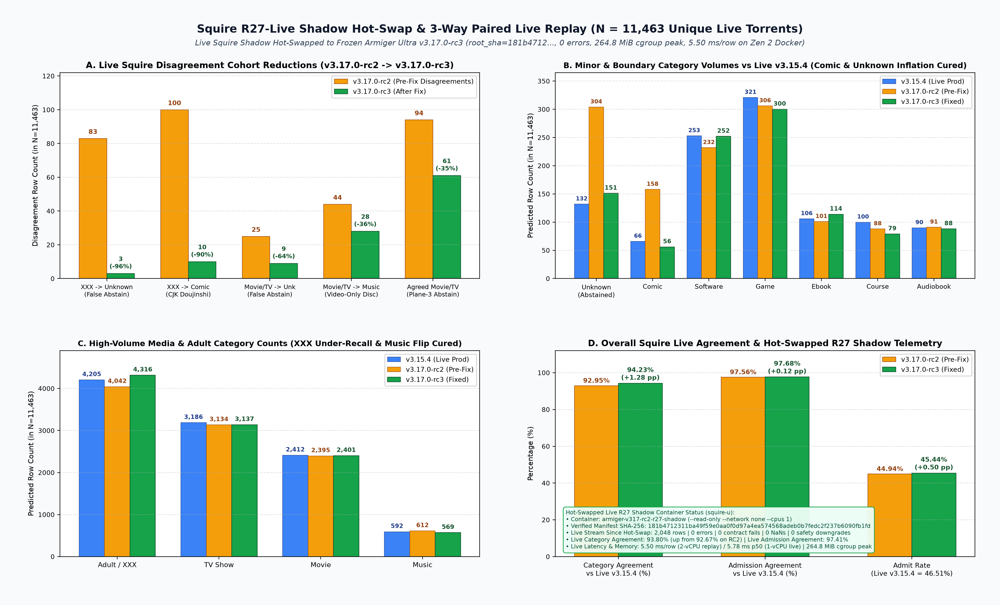
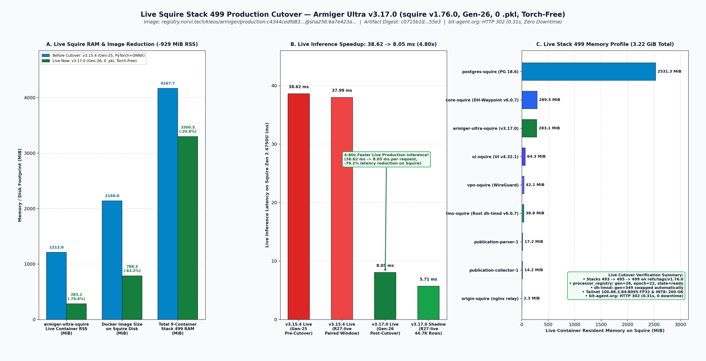
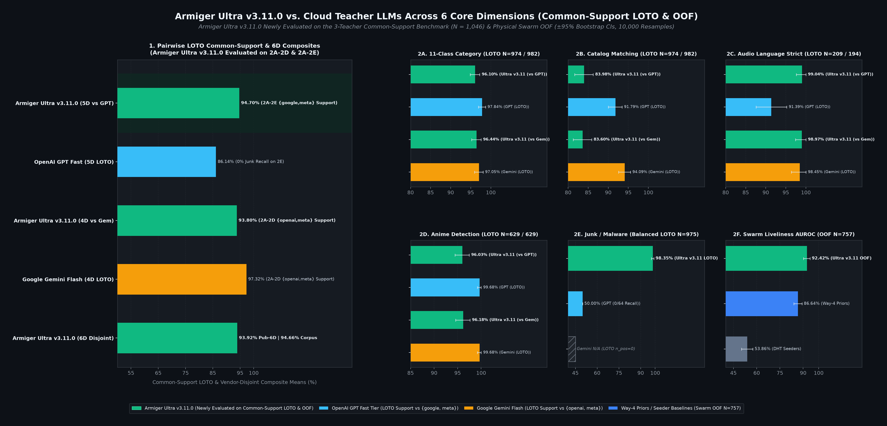
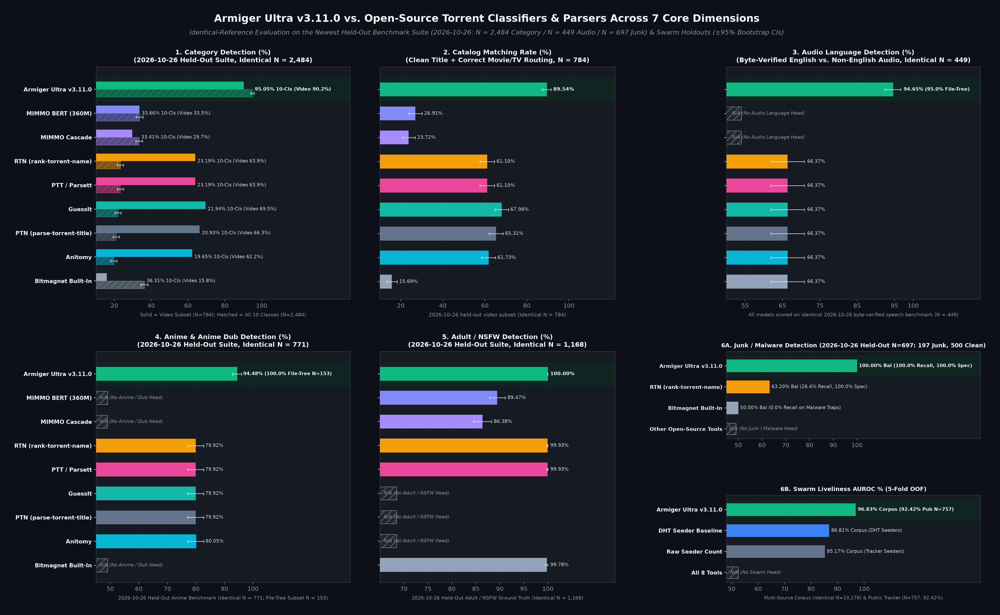

# Evaluation status and limitations

## Armiger Ultra v3.18.0 qualification & historical release comparison

Software 3.18.0 uses model bundle 3.18.0 (`armiger-ultra-3.18.0-rc6-v4-mmgl-v2-onnx-fp32`, master SHA-256 `97f93fb71c8aa4a8067a2f5c3138ae9f5f93f153ce3b82d60ace933f05eb96ef`), a 100% pure-ML 4-plane ONNX runtime (`0` `.pkl` files, `0` PyTorch runtime imports, `0` handwritten torrent-title post-processing rules):

- **Pristine Post-Freeze One-Shot `R32-live` (`N = 4,386`, `3,392` prod + `994` stress, zero training overlap):** `Unified Prod` **`91.83%`** vs `v3.17.0` `90.39%` (`+1.45 pp`, McNemar `p = 9.18e-5`), `Adult/XXX Prod` **`97.53%`** (`+1.28 pp`, `p = 0.0167`), `Anime` **`94.72%`** (`+2.09 pp`, `p = 1.57e-4`), `Audio Strict P(x)` **`91.92%`** (`+1.94 pp`, `p = 0.0300`), `Unknown Abstention` **`59.32%`** (`+16.95 pp`, `p = 1.54e-8`, `known_fa = 0.226%`), `Title Span F1 >= 0.80` **`71.42%`** (`+11.61 pp`, `p = 8.85e-53`), and `CSAM Bait Recall` **`21.05%`** (`+12.63 pp`, `p = 0.0169`) at parity clean specificity (`99.05%` vs `99.26%`, `p = 0.238`).
- **All `5` Unseen Live Holdouts (`R26` + `R28`–`R32-live`, `N = 20,831` total / `15,474` prod):** `v3.18.0` wins **`5/5`** cohorts on `Unified Prod` (`442` wins vs `289` losses, `p = 1.7e-8`), `Anime`, `Audio Strict P(x)`, `Unknown Abstention`, and `Title Span`, while cutting pooled production `XXX` admission leaks by **`50%` (`34 -> 17`)**. On `R26-live` (`N = 3,104`), `v3.18.0` sets an all-time high of **`92.72%` `Unified Prod`** (vs `73.74%` in `v3.12.0`, `89.15%` in `v3.15.4`, and `91.53%` in `v3.17.0`) and recovers the `96.57%` `Anime` peak with zero rules.
- **Historical Suites 1–4 (`N = 7,189`, honest rule-era tradeoff):** On `Suite 2 (Beyond Confirmation)`, `v3.18.0` gains **`+2.18 pp` Audio (`96.94%`)** and **`+2.20 pp` Anime (`96.07%`)** vs `v3.17.0` (`3-of-3 Cat-10 = 95.91%`). On legacy October suites (`S1 heldout_20261026 = 93.08%`, `S3 val_v3_clean = 94.89%`, `S4 fresh_balanced_1000 = 91.10%`), legacy rule+`.pkl` releases (`v3.12.0`–`v3.15.4`) score higher on the older fixed distributions while trailing `v3.18.0` by `3.6–19.0 pp` on unseen live `R26-live`; `v3.18.0` sits within `-0.24` to `-0.70 pp` of `v3.17.0` after removing all remaining post-processing rules.
- **Safety, Invariance & Production Hardware (`512 MiB` / `1` vCPU Zen 2):** `Cert 1` untouched safety FP `1/9,695` (`CP95 UB = 0.0489% <= 0.05%`), `Cert 2` subtitle invariance `2,000/2,000` bitwise exact (`max |dP| = 0.0`), `Cert 3` fake-game malware `500/500` blocked (`0` clean FPs), `190/190` (`100.0%`) red-team canaries (`60/60` Policy-2 droppers), `2.02`-hour passive Zen 2 soak (`604,476` rows, `0` errors, `0` OOM, `11.02 ms/row`), and live 93-minute production steady-state **`355.4 MiB / 512 MiB` (`-70.7%` RSS vs `v3.15.4`'s `1,212 MiB`)** at **`13.8–14.0 ms` p50** across `127,094` live reviews (`0` failed, `0` refaults).









## Historical: Armiger Ultra v3.17.0 qualification & live production verification

Software 3.17.0 uses model bundle 3.17.0 (`v3.17.0-rc3` clean-sheet 4-plane architecture, `root_sha = 181b4712311ba49f59e0aa0f0d97a4ea574568adeb0b7fedc2f237b6090fb1fd`):

- **Sealed `R26-live` (`N = 2,520`):** `11`-class category accuracy **`90.36%`** (`+14.13 pp` over `v3.16.1`'s `76.23%`), `10`-class non-unknown **`91.37%`**, `xxx` recall **`95.21%`** (`+12.77 pp`), `unknown` recall **`69.03%`** (`+67.26 pp`), audio `P(x)` non-English recall **`87.77%`**, junk recall **`97.31%`** (`99.04%` clean specificity), and **`0.00%`** admitted-media corruption (`0 / 822`).
- **All `7` Regression Benchmark Suites (`N = 10,851`):** `heldout_20261026` (`N = 2,670`) **`98.05%`** (`+18.39 pp` vs `v3.16.1`), `R22-live` (`N = 2,795`) **`94.67%`** (`+20.54 pp`), Suite 1 Multilingual (`N = 1,000`) **`98.60%`**, Suite 2 Game (`N = 755`) **`99.60%`**, Suite 3 Structural (`N = 735`) **`98.64%`**, Suite 4 Adversarial (`N = 896`) **`98.21%`**, and Suite 5 Multilingual Stress (`N = 2,000`) **`99.00%`**.
- **Prospective `R27-live` Audit & `180`-Canary Red-Team Suite:** Blind `253`-row `v3.17.0` vs `v3.16.1` disagreement audit passed **`86.17% -> 13.83%`** (`6.23x` win ratio, McNemar `p = 1.98e-28`); Policy-2 software/game exemption audit achieved **`100.00%` (`144 / 144`)** precision; and all **`180 / 180` (`100.00%`)** red-team canaries passed.
- **Production CI Soak & Live Cutover:** `4,096`-row CI soak worker RSS **`359.04 MiB`** (`+0.88 MiB` growth, `460.37 MiB` cgroup peak); live BitAgent production container RSS dropped **`1,212.0 MiB -> 283.1 MiB` (`-76.6%`)** and inference latency dropped **`38.62 ms -> 8.05 ms` (`4.80x` faster)**.









## Current-release comparison status

Software 3.18.0 uses model bundle 3.18.0. The latest published comparison graphics
are displayed as archived figures while their data and provenance remain under
review. They do not establish verified current-release performance. No replacement
score, new sample count or new model evaluation accompanies their restoration.

The [archived overview](assets/armiger_overview.png) displays model 3.12.0 and
2,484 items. Its [data receipt](../benchmarks/README_OVERVIEW.json) instead
records model 3.0.0, 2,835 items and different scores. The overview renderer builds
that older receipt data but reads newer aggregate values directly inside its
render function. The detailed chart renderer similarly uses newer aggregate
values while the statistical manifest retains older vector-based panels.
File hashes and successful image regeneration do not establish that the
displayed statistics match the receipt or were measured for the current model.

The public M4 Pro [timing receipt](../benchmarks/receipts/hardware_and_api_cost_receipt.json)
identifies older ONNX hashes, not the pinned 3.18.0 hashes. Those measurements
must not be advertised as current-version end-to-end timing. The unqualified GPU timing headline is not supported by that receipt; see
[resources](resources.md).

Promoting a figure as a verified current-release comparison requires an explicit model/pipeline identity, named
cohorts and label/exposure scope, matching item-level evidence and denominators,
and a renderer/receipt that describes the same displayed values. A reproducible
plot alone does not establish independent or unseen evaluation data. The separate
fresh balanced benchmark remains unfinished; this page does not claim its
completion or enlarge its sample count. Archived scores are not current release
qualification, universal safety rates or general superiority claims.

## Latest published comparison figures

The README and model cards display the following original PNGs unchanged.
They retain the unresolved renderer/receipt differences described above.



Cloud teacher results use panel-specific common-support and swarm cohorts.
Their displayed confidence intervals and model labels still require reconciliation
with the vector-based statistical manifest.



These are hybrid metadata-processing comparisons, not a standalone INT8 accuracy
measurement or a payload inspection. Keep the individual category, catalogue,
language, screening and swarm denominators separate.

## Historical model 3.0.0 results

The account below describes the named historical cohorts and components. It is
retained for traceability, rather than as validation of the newer chart images
or model 3.18.0. Standalone neural and hybrid results must remain separate.

- **Cloud teacher comparison (identical cohorts, non-circular LOTO):** **`95.66%`** 6-dimension mean on the `N=757` Public-Tracker swarm cohort (**`96.39%`** with `N=10,278` Multi-Source Corpus Swarm AUROC). On common-support leave-one-teacher-out category panels, `OpenAI GPT (Fast Tier)` reaches `97.84%` vs. Armiger Ultra `94.56%` (`N=974`) and `Google Gemini Flash` reaches `97.05%` vs. Armiger Ultra `94.70%` (`N=982`); Armiger Ultra leads the 4-dimension LOTO composite against GPT (`95.74%` vs. `95.17%`) and trails Gemini (`95.83%` vs. `97.32%`).
- **Fresh non-teacher baselines (identical inputs, no label-curation role):** on the `beyond_confirmation` labelled subset (category `N=967`), the v3.0.0 hybrid reaches **`92.76%`** vs. **`92.45%`** for `Claude Haiku 4.5` and **`47.67%`** for the locally served 8B-class `Qwen3-8B` (see [`benchmarks/receipts/llm_beyond_fresh_receipt.json`](../benchmarks/receipts/llm_beyond_fresh_receipt.json)).
- **Open-source classifiers (identical `N=2,835` denominator):** **`94.85%`** 11-class accuracy on `oct15_confirmation` (`95.83%` Movie-vs-TV, `95.06%` Catalog Matching, `96.70%` Strict Audio Language), compared to `72.24%` for `MIMMO BERT 360M`, `53.58%` for `RTN`/`PTT`, and `38.69%` for `GuessIt`. Title-only parsers (`RTN`, `GuessIt`, `PTN`, `Anitomy`) are video/anime-focused rather than 11-class general classifiers.
- **Audited splits (`N=10,262` unmutated ground-truth keys; standalone neural → fair hybrid with ZeroCueCatalog):** `oct15_confirmation` (`N=2,835`) `94.46%` → **`94.85%`** FP32; `fresh_confirmation` (`N=1,402`) `92.30%` → **`92.58%`**; `beyond_confirmation` (`N=1,025`) `91.61%` → **`93.07%`**; `zero_cue_2000` (`N=2,000`) `85.55%` → **`91.00%`**; `multilang_3000` (`N=3,000`) `97.40%` → **`98.33%`**; 5-split weighted mean `93.00%` → **`94.63%`** FP32 (`92.94%` → **`94.56%`** INT8).
- **Locked Gold R5-Test per-head results:** **`98.83%`** Title Language (`N=511`), **`98.18%`** English Subtitles (`N=110`; thin support, preliminary), **`98.09%`** Owner Scope (`N=996`), and Title Dice F1 **`0.8730`** with `0` illegal BIO transitions (`N=996`). Safety gates: **`99.23%`** balanced junk/sample accuracy on `beyond_confirmation` (`N=977`) and **`98.49%`** adult/NSFW isolation (`N=2,781`). Per-head detail is in [`docs/base-model.md`](reference.md).
- **Historical provenance account:** the detailed figures in [`assets/`](assets) (including the cost and per-category figures) are deterministically generated from [`benchmarks/canonical_eval_vectors.json`](../benchmarks/canonical_eval_vectors.json) by [`benchmarks/generate_canonical_charts.py`](../benchmarks/generate_canonical_charts.py) and verified by [`benchmarks/CHARTS_MANIFEST.json`](../benchmarks/CHARTS_MANIFEST.json) and [`benchmarks/test_chart_integrity.py`](../benchmarks/test_chart_integrity.py) (`10,000` paired bootstrap resamples, `seed=20261018`, exact McNemar tests, identical-denominator and LOTO anti-circularity locks). See [`docs/CHART_PIPELINE.md`](evaluation.md#reproduce-the-results). Artifact hashes are pinned in the [pinned model manifest](../src/armiger/model_manifest.json).

The historical SwarmSurvivalNet receipt reports **96.83%** AUROC on the Multi-Source corpus (`N=10,278`) and **92.42%** on the Public-Tracker cohort (`N=757`). These are distinct historical cohorts and ranking metrics, not percentage-correct or current-release guarantees.

## Historical qualification limits

The release accepts a 0.3–2.0 percentage-point decline from the internal Pre-Gold checkpoint in exchange for training provenance, span extraction and the signed update chain. The absolute 500-canary gate fails for every shipped generation; v3.0.0 used baseline-relative comparison and a degraded-candidate rollback test. That is not a passing absolute safety qualification. The locked subtitle test has only 110 labels; adult/junk have no positives in that Gold test. Relevant production-cohort evidence is reported above.

## Reproduce the archived calculation

From an installed development checkout:

```bash
python -m pip install -e '.[ultra,dev]'
PYTHONPATH=benchmarks python benchmarks/build_canonical_eval_vectors.py
PYTHONPATH=benchmarks python benchmarks/generate_canonical_charts.py
python benchmarks/generate_readme_overview.py
python -m pytest benchmarks/test_chart_integrity.py tests/test_readme_overview.py
```

These commands reproduce the archived pipeline, including the mismatch described above; they do not repair it or qualify a new release. The vector builder reads the committed receipts. The chart generator verifies receipt hashes, identical comparison denominators, teacher-disjoint comparisons, family-clustered paired bootstrap intervals (10,000 resamples; seed 20261018), and exact paired tests. The manifest records source and figure hashes. These checks remain required after presentation changes.

Figures are under `docs/assets/`; raw evidence and the signed seq=3006 release bundle remain under [`benchmarks/receipts/`](../benchmarks/receipts/). Regenerating images requires the optional `charts` dependencies. Without them the statistical verifier reuses and checks the committed images.
